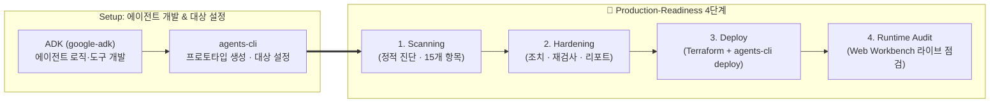

# 🛡️ Production-Ready Enterprise AI Agent Platform (v2.1)

<p align="center">
  <a href="#-한국어-가이드-korean"><strong>🇰🇷 한국어 가이드 (Korean)</strong></a> ·
  <a href="#-english-guide"><strong>🇺🇸 English Guide</strong></a>
</p>

---

<a id="-한국어-가이드-korean"></a>

# 🇰🇷 한국어 가이드 (Korean)

## 💡 한 줄 요약: 이 도구는 무엇인가요?
개발자가 로컬에서 만든 **AI 에이전트 프로토타입(`adk create` 또는 `agents-cli scaffold`)**을 스캔하여, **`Agent Runtime`과 `Cloud Run` 각 타겟의 아키텍처 특성에 맞춰 엔터프라이즈 상용 수준(Production-Ready)으로 배포할 수 있도록 7대 영역 · 15개 핵심(True No-Regret + GEAP Governance) 보안·신원·거버넌스·네트워크·세션·관측성·비용·품질 설정(`Terraform` + `ADK 플러그인`)을 진단하고 자동으로 보강(Hardening)해 주는 도구**입니다.

### ✨ v2.1 핵심 설계 원칙
1. **과도한 인프라 강제 변경 금지 (Zero Over-Reaching Mutations)**:
   - CPU·메모리·`concurrency`·`min_instances`는 부하 테스트(`Locust`) 없이 강제 상향하지 않고 기존 값을 그대로 보존합니다.
   - GCLB + Cloud Armor WAF / IAP 및 `default_uri_disabled` 인바운드 잠금, 조직 Billing Admin 권한이 필요한 `budget.tf`, `deletion_protection = true`, GCS 로그 버킷 강제 Versioning, 임의 카나리 셸 스크립트, **앱 코드 내 Model Armor/도구 거버넌스 플러그인**은 강제 생성하지 않습니다. *(컴퓨트 사이징, 인바운드 인증/엣지 토폴로지, Model Armor Floor Settings, 프로덕션 SLA(`Provisioned Throughput GSU`)는 아키텍처 참고 권고(**Advisory**)로만 안내)*
2. **런타임 맞춤형 GEAP 거버넌스 (`C4.2` & `C4.4`)**:
   - **`C4.2` Agent Identity (SPIFFE ID) & Agent Registry 자동 등록**: **`Cloud Run`과 `Agent Runtime` 모두**에 적용합니다. (`agentregistry.googleapis.com`·`apphub.googleapis.com` 활성화 + 기존 `service_account` 상호 배타성 자동 정리)
   - **`C4.4` Agent Gateway 중앙 정책 게이트웨이**: **`Agent Runtime`에만 우선 적용**(`AGENT_TO_ANYWHERE` + UAP V2 `AuthzExtension`/`AuthzPolicy`, 초기 **`DRY_RUN`**으로 HTTP 498 장애 방지 + `Dockerfile` `AGENT_GATEWAY_ROOT_CERTIFICATES`)하고, **`Cloud Run`**에는 인프라를 강제 생성하지 않고 `service.tf`에 단계적 도입 아키텍처 주석만 반영합니다. *(Cloud Run은 Direct VPC Egress + SWP/VPC-SC + IAP + Model Armor라는 검증된 GA 인프라 보안 위에 Agent Identity / Registry / Self-Managed AGW를 단계적으로 얹는 접근이 가장 현실적입니다.)*
3. **D2 Managed-First 원칙**: 멀티턴 세션(`C2.1`)과 장기 기억(`C2.2`)은 운영 부담이 없는 **Agent Platform Managed Sessions (`VertexAiSessionService`) & Memory Bank (`VertexAiMemoryBankService`)** 를 기본으로 구성합니다. *(규제·기존 인프라 재사용 시 Self-Hosted Cloud SQL / Redis / Vector DB도 별도 옵션으로 선택 가능)*
4. **`Cloud Run` vs `Agent Runtime` 엄격 분리**: `Agent Runtime`은 4개 플랫폼 내장 항목(`C1.1, C1.2, C2.1, C5.1`)을 `MANAGED_NATIVE`로 자동 처리하고 `ReasoningEngine` 전용 메트릭·PSC-I·Agent Gateway만 적용하며, `Cloud Run`은 기존 VPC/서브넷을 재사용하는 Direct VPC Egress(`var.vpc_network_name` / `var.vpc_subnet_name`)와 Cloud Run PromQL 5xx 알람을 구성합니다.

---

## 🎯 왜 이 프로젝트가 필요한가요? (배경 및 목적)

1. **프로토타입(Day-1)과 엔터프라이즈 상용화(Day-2) 사이의 공백 해소**:
   - **ADK (`google-adk`)**로 에이전트 로직을 빠르게 만들고, **`agents-cli` (`google-agents-cli`)**로 기본 스캐폴딩·평가·배포를 수행할 수 있습니다.
   - 하지만 실제 기업 상용 오픈을 위해서는 **사내 폐쇄망 연동, 영속 세션/장기기억, 최소 권한 SA & Agent Identity/Registry, Agent Gateway(AR), Non-Root 컨테이너 격리, 트레이스 PII 유출 차단(`NO_CONTENT`), 턴별 무한 루프 상한, 429 Fail-Fast 백오프 & Global DSQ, 타겟별 SRE 알람, 공식 Eval 품질 게이트**가 필수입니다.
2. **플랫폼 간 Production-Ready 격차 해소 (`Cloud Run` vs `Agent Runtime`)**:
   - **Agent Runtime**은 4개 런타임/프로브/세션/트레이싱 영역을 플랫폼이 기본 제공하는 반면, **Cloud Run**에서는 이를 코드와 Terraform으로 직접 구성해야 합니다.
   - 본 프로젝트는 **7대 영역 · 15개 핵심 체크리스트(`C1.1`~`C7.1`)**로 양 플랫폼 모두에서 **100% Production-Ready** 상태에 도달할 수 있게 해줍니다.



---

## 🔍 무엇을 체크하고 어떻게 조치해 주나요? (7대 영역 · 15개 핵심 항목 상세)

### 1️⃣ 런타임 & 헬스체크 (Runtime & Probes)
> 💡 **사이징 보존**: `cpu`, `memory`, `concurrency`, `min_instances`는 강제 상향하지 않으며 `Locust` 부하 테스트 권고(`Advisory`)로만 안내합니다.

| ID | 점검 항목 | Cloud Run (`cloud_run`) | Agent Runtime (`agent_runtime`) | 생성/수정 파일 |
| :---: | :--- | :--- | :--- | :--- |
| **`C1.1`** | **런타임 IaC 선언 & 드리프트 방지** | `agents-cli` v1.5.0 호환 `google_cloud_run_v2_service.app` + `lifecycle.ignore_changes` 선언/유지 | 🟢 **MANAGED_NATIVE** (`google_vertex_ai_reasoning_engine.app` + `lifecycle.ignore_changes`) | `deployment/terraform/service.tf` |
| **`C1.2`** | **헬스 프로브 & Startup CPU Boost** | `/list-apps:8080` 대상 `startup_probe` · `liveness_probe` + `startup_cpu_boost = true` 추가 *(기존 CPU/메모리/min_instances 보존)* | 🟢 **MANAGED_NATIVE** (플랫폼 내장 헬스체크 & 라이프사이클) | `deployment/terraform/service.tf`, `app/fast_api_app.py` |

### 2️⃣ 세션 & 장기 기억 영속성 (Session & Memory)
> 💡 **Managed-First 기본 제공**: 별도 DB 운영 부담이 없는 **Agent Platform Managed Sessions & Memory Bank**를 기본 연결합니다. *(규제·기존 인프라 재사용 시 Self-Hosted Cloud SQL / Memorystore Redis / Vector DB도 별도 옵션으로 구성 가능)*

| ID | 점검 항목 | Cloud Run (`cloud_run`) | Agent Runtime (`agent_runtime`) | 생성/수정 파일 |
| :---: | :--- | :--- | :--- | :--- |
| **`C2.1`** | **멀티턴 영구 세션 (Managed Sessions)** | `InMemorySessionService` 제거 → **`VertexAiSessionService`** + `AGENT_ENGINE_SESSION_ID` 연동 *(Cloud Run OTel 리소스 감지 보존 · Self-Hosted DB는 참고 옵션)* | 🟢 **MANAGED_NATIVE** (플랫폼 내장 Managed Session Service) | `app/app_utils/services.py`, `app/fast_api_app.py`, `deployment/terraform/service.tf` |
| **`C2.2`** | **크로스-세션 장기 기억 (Memory Bank)** | **`VertexAiMemoryBankService`** (`shared://memory`) + `after_agent_callback` (`auto_save_session_to_memory`) 장착 | Cloud Run과 동일 (`VertexAiMemoryBankService` + 자동 저장 콜백) | `app/app_utils/services.py`, `app/agent.py`, `app/fast_api_app.py` |

### 3️⃣ 사내망 프라이빗 아웃바운드 (Private VPC Egress)
> 💡 **인바운드 & 인증 아키텍처 (Advisory)**: 퍼블릭 URL + 자체 OAuth/JWT, 서버 간 IAM Invoker, 사내 IAP, 또는 앞단 GCLB + Cloud Armor WAF 여부는 조직 보안 정책과 호출자 유형에 따라 결정되므로 `service.tf`의 `ingress` / `default_uri_disabled`는 강제 변경하지 않습니다.

| ID | 점검 항목 | Cloud Run (`cloud_run`) | Agent Runtime (`agent_runtime`) | 생성/수정 파일 |
| :---: | :--- | :--- | :--- | :--- |
| **`C3.1`** | **사내 VPC 프라이빗 아웃바운드** *(사내 DB·내부 API 연동 시)* | `service.tf`에 `Direct VPC Egress (PRIVATE_RANGES_ONLY)` 바인딩 (`var.vpc_network_name` / `var.vpc_subnet_name` 재사용으로 CIDR 충돌 방지) | `PSC Interface (google_compute_network_attachment)` 생성 후 `service.tf` `psc_interface_config`에 직접 연결 + `/28` PGA 서브넷 | `deployment/terraform/service.tf`, `deployment/terraform/variables.tf`, `production_ready.tf` *(AR)* |

### 4️⃣ 보안, 신원 & 거버넌스 (Security, Identity & Governance)
> 💡 **Cloud Run vs Agent Runtime 거버넌스 전략**: **Agent Identity & Registry(`C4.2`)**는 두 런타임 모두에 적용하며, **Agent Gateway(`C4.4`)**는 **Agent Runtime에 우선 적용**(`DRY_RUN` 기본)하고 Cloud Run에는 검증된 GA 보안 위에 단계적 도입을 안내하는 주석만 반영합니다. Model Armor Floor Settings는 아키텍처 참고 권고(Advisory)로 안내합니다.

| ID | 점검 항목 | Cloud Run (`cloud_run`) | Agent Runtime (`agent_runtime`) | 생성/수정 파일 |
| :---: | :--- | :--- | :--- | :--- |
| **`C4.1`** | **최소 권한 SA & Secret 버전 고정** | `roles/storage.admin` → **`roles/storage.objectUser`** 축소, Secret 버전 고정 *(삭제 보호 `deletion_protection`은 기존 값 유지)* | `roles/storage.objectUser` 축소 + 불필요한 `roles/cloudsql.client` 제거, Secret 버전 고정 | `deployment/terraform/variables.tf`, `deployment/terraform/service.tf` |
| **`C4.2`** | **Agent Identity (SPIFFE ID) & Agent Registry** | `FUNCTIONAL_TYPE_AGENT` + `IDENTITY_TYPE_AGENT_IDENTITY` + `agentregistry.googleapis.com` *(MCP 서버 자동 감지 시 `FUNCTIONAL_TYPE_MCP_SERVER` + 전용 SA 유지, 하드코딩 MCP/A2A URL은 `AMBER` + `AgentRegistry` 전환 안내)* | `spec.identity_type = "AGENT_IDENTITY"` + `agentregistry.googleapis.com` *(하드코딩 MCP/A2A URL 감지 시 `AMBER` + `AgentRegistry` Lazy Discovery 전환 안내)* | `deployment/terraform/service.tf`, `deployment/terraform/apis.tf` |
| **`C4.3`** | **컨테이너 Non-Root & Gen2 샌드박스** | `Dockerfile` **`USER 10001:10001`** + Cloud Run **`EXECUTION_ENVIRONMENT_GEN2`** | `Dockerfile` **`USER 10001:10001`** | `Dockerfile`, `deployment/terraform/service.tf` |
| **`C4.4`** | **Agent Gateway 중앙 정책 게이트웨이** | 🔵 **Comment Advisory (`TIER_2_TEMPLATE`)** — `service.tf`에 단계적 도입 아키텍처 주석만 반영 *(Direct VPC Egress + SWP/VPC-SC + IAP + Model Armor GA 보안 위 단계적 적용 · 인프라 강제 생성 없음)* | `google_network_services_agent_gateway` (`AGENT_TO_ANYWHERE`) + UAP V2 `AuthzExtension`/`AuthzPolicy` (기본 **`DRY_RUN`**으로 HTTP 498 장애 방지) + `agent_gateway_config` + `Dockerfile` `AGENT_GATEWAY_ROOT_CERTIFICATES` | `deployment/terraform/service.tf`, `production_ready.tf` *(AR)*, `Dockerfile` *(AR)* |

### 5️⃣ 관측성, 프라이버시 & 타겟별 SRE 알람 (Observability & Alerts)
| ID | 점검 항목 | Cloud Run (`cloud_run`) | Agent Runtime (`agent_runtime`) | 생성/수정 파일 |
| :---: | :--- | :--- | :--- | :--- |
| **`C5.1`** | **OpenTelemetry GenAI 분산 트레이싱** | `OTEL_SEMCONV_STABILITY_OPT_IN="gen_ai_latest_experimental"` + `otel_to_cloud = True` + `google-adk[gcp,otel-gcp]` + `roles/monitoring.metricWriter` | 🟢 **MANAGED_NATIVE** (`GOOGLE_CLOUD_AGENT_ENGINE_ENABLE_TELEMETRY="true"`) | `deployment/terraform/service.tf`, `app/fast_api_app.py`, `pyproject.toml`, `deployment/terraform/variables.tf` |
| **`C5.2`** | **트레이스 `NO_CONTENT` 프라이버시** | `OTEL_INSTRUMENTATION_GENAI_CAPTURE_MESSAGE_CONTENT="NO_CONTENT"` + `ADK_CAPTURE_MESSAGE_CONTENT_IN_SPANS="false"` | Cloud Run과 동일 (`service.tf` 환경변수) | `deployment/terraform/service.tf` |
| **`C5.3`** | **타겟별 SRE 골든 시그널 알람** | `cloud_run_revision` P95 지연(`> 15s`) · **PromQL 5xx 비율(`> 2%`)** 알럿 | **`aiplatform.googleapis.com/ReasoningEngine`** 전용 지연/에러 메트릭 알럿 | `deployment/terraform/alerts.tf` |

### 6️⃣ FinOps 비용 통제 & 쿼터 회복력 (FinOps & Resilience)
> 💡 **프로덕션 429 SLA 권고 (Advisory)**: DSQ는 유동적 공유 풀이므로 재시도(`attempts=3` Fail-Fast)만으로 고정 트래픽 SLA를 보장하지 않습니다. 엄격한 상용 SLA에는 **Provisioned Throughput(GSU) + Shared spillover** 또는 **Priority PayGo**를 검토하세요.

| ID | 점검 항목 | Cloud Run (`cloud_run`) | Agent Runtime (`agent_runtime`) | 생성/수정 파일 |
| :---: | :--- | :--- | :--- | :--- |
| **`C6.1`** | **턴별 무한 루프 차단 & 선택적 토큰 캡** | `invocation_id` 기반 턴별 LLM 호출 상한(`max_llm_calls_per_turn`) + Gemini 2.5/3.x Thinking 모델 안전 Opt-In `max_output_tokens`(기본 `0`=무제한) | Cloud Run과 동일 | `app/app_utils/cost_guard_plugin.py`, `app/agent.py` |
| **`C6.2`** | **429 DSQ Fail-Fast 백오프 & Global DSQ** | `HttpRetryOptions(attempts=3, initial_delay=1.0, max_delay=15.0, exp_base=2.0, jitter=1.0)` 유지/주입 *(Retry Storm 방지)* + `GOOGLE_CLOUD_LOCATION` (`"global"` 또는 레지던시 리전) | Cloud Run과 동일 | `app/agent.py`, `deployment/terraform/service.tf` |

### 7️⃣ Day-2 CI/CD 품질 게이트 (CI/CD & Eval Gate)
| ID | 점검 항목 | Cloud Run (`cloud_run`) | Agent Runtime (`agent_runtime`) | 생성/수정 파일 |
| :---: | :--- | :--- | :--- | :--- |
| **`C7.1`** | **공식 `agents-cli eval run` 품질 게이트** | `.cloudbuild/staging.yaml`에 공식 `uvx google-agents-cli eval run --dataset ... --metrics ...` + `tests/eval/eval_config.yaml` + `smoke_dataset.json` 추가 | Cloud Run과 동일 | `.cloudbuild/staging.yaml`, `tests/eval/eval_config.yaml`, `tests/eval/datasets/smoke_dataset.json` |

---

## 📦 사전 준비 및 필수 CLI 설치 (Prerequisites & Setup)

| 구분 | 필요한 도구 | 언제 필요한가요? | 설치 및 초기 설정 명령어 |
| :--- | :--- | :--- | :--- |
| **필수 (공통)** | **`Python 3.10+` & [`uv`](https://docs.astral.sh/uv/)** | 로컬 진단(`scan`), 패치(`apply`), 웹 워크벤치(`ui`) 및 `agents-cli` 실행 시 필수 | `curl -LsSf https://astral.sh/uv/install.sh \| sh` |
| **권장 (에이전트 생성 & 배포)** | **[`google-agents-cli`](https://github.com/google/agents-cli) (`agents-cli` v1.5.0+)** | 신규 ADK 에이전트 스캐폴딩(`agents-cli scaffold`), 품질 평가(`eval run`), GCP 배포(`deploy`) 시 사용 | `uv tool install "google-agents-cli~=1.5.0"`<br/>`uvx google-agents-cli setup`<br/>`agents-cli info` |
| **선택 (방법 1️⃣ 사용 시)** | **[Antigravity IDE / CLI](https://antigravity.google/)**<br/>*(또는 Gemini CLI, Claude Code)* | **방법 1️⃣(채팅으로 진단·패치)** 사용 시 필요 | `mkdir -p ~/.gemini/skills`<br/>`cp -r skills/agent-production-readiness ~/.gemini/skills/` |
| **선택 (실제 GCP 배포 시)** | **[`gcloud` CLI](https://cloud.google.com/sdk/docs/install) & [`Terraform >= 1.5`](https://developer.hashicorp.com/terraform/install)** | 로컬 패치(전체 항목 충족) 완료 후 실제 Google Cloud에 배포할 때만 필요 | `gcloud auth login`<br/>`gcloud auth application-default login`<br/>`gcloud config set project 내_GCP_프로젝트_ID` |

---

## 🚀 어떻게 사용하나요? (3가지 방법 중 편한 방법 선택)

### 방법 1️⃣: Antigravity (또는 Gemini CLI)에서 **채팅으로** 사용하기 *(가장 추천)*
1. **내 환경에 스킬 설치하기 (최초 1회)**:
   ```bash
   rm -rf ~/.gemini/skills/agent-production-readiness && mkdir -p ~/.gemini/skills
   curl -fsSL "https://github.com/kiwonilee/production-ready-agent-platform/archive/refs/heads/main.tar.gz" | tar -xz -C ~/.gemini/skills/ --strip-components=2 production-ready-agent-platform-main/skills/agent-production-readiness
   ```
2. **내가 개발 중인 에이전트 폴더를 열고 채팅창에 말하기**:
   - 💬 *"이 에이전트 프로덕션 준비 상태를 스캔해서 항목별 충족 현황을 요약해줘"* *(먼저 3개 프로필 + 직접 맞춤 조합 중 선택 후 진단 진행)*
   - 💬 *"부족한 항목들 Diff 보여주고 전부 적용해줘"*
   - 💬 *"보안성 심의 제출용 리포트(`READINESS_REPORT.md` / `.html`) 만들어줘"*

### 방법 2️⃣: 브라우저 **웹 화면(Workbench UI)**을 띄워서 마우스 클릭으로 사용하기
```bash
uv run prod-ready ui samples/02_cloud_run_agent --port 8090
```
브라우저에서 **`http://127.0.0.1:8090`**을 열면 **15개 체크포인트 진단**, **실시간 Diff 미리보기**, **원클릭 적용**, **HTML 심의 리포트 발급**, 그리고 **`/lab` 핸즈온 가이드**까지 한 번에 확인할 수 있습니다.

### 방법 3️⃣: 터미널에서 **명령어(`prod-ready`)**로 빠르게 사용하기
```bash
# 🎬 3단계 Before(scan) -> Patch(apply) -> After(scan & report) 라이브 데모
uv run prod-ready demo samples/02_cloud_run_agent

# 개별 실행 예시
uv run prod-ready scan samples/02_cloud_run_agent --items ALL
uv run prod-ready diff samples/02_cloud_run_agent --items ALL --params '{"vpc_subnet_name":"default"}'
uv run prod-ready apply samples/02_cloud_run_agent --items ALL --params '{"vpc_subnet_name":"default"}'
uv run prod-ready report samples/02_cloud_run_agent --items ALL -o READINESS_REPORT.md
uv run prod-ready reset samples/02_cloud_run_agent
```

---
---

<a id="-english-guide"></a>

# 🇺🇸 English Guide

## 💡 What is this in one sentence?
This toolkit bridges the **Day-2 Production Readiness Gap** after **ADK (`google-adk`)** and **`agents-cli` (`google-agents-cli`)**: it scans your local agent project against a **7-Domain, 15-Item True No-Regret + GEAP Governance Production Checklist (`C1.1`–`C7.1`, v2.1)** with strict runtime differentiation between **Cloud Run** and **Agent Runtime**, and **automatically patches your Terraform and Python ADK code in-place**.

### Key v2.1 Engineering Principles
- **Zero Over-Reaching Mutations**: Existing `cpu`, `memory`, `concurrency`, `min_instances`, `ingress`, `default_uri_disabled`, and `deletion_protection` are preserved untouched; no forced GCLB/Cloud Armor WAF, no Billing Account `budget.tf`, no GCS log bucket versioning, no dummy shell scripts, and no mandatory in-app Model Armor / tool governance boilerplate. Compute sizing, inbound auth/edge topology, Model Armor Floor Settings, and Production SLA (**Provisioned Throughput GSU / Priority PayGo**) are surfaced as architecture & governance **Advisories**.
- **Runtime-Tailored GEAP Governance (`C4.2` & `C4.4`)**: **Agent Identity (SPIFFE ID) & Agent Registry (`C4.2`)** is applied to **BOTH** `cloud_run` and `agent_runtime`. **Agent Gateway (`C4.4`, `AGENT_TO_ANYWHERE` + UAP V2 `DRY_RUN` default to prevent HTTP 498 outages + `AGENT_GATEWAY_ROOT_CERTIFICATES`)** is applied **ONLY to `agent_runtime`**, while `cloud_run` receives a non-blocking architectural comment in `service.tf` guiding staged adoption on top of proven GA infrastructure security (Direct VPC Egress + SWP/VPC-SC + IAP + Model Armor).
- **Managed-First Session & Memory (`D2`)**: Wires **Agent Platform Managed Sessions (`VertexAiSessionService`)** and **Memory Bank (`VertexAiMemoryBankService`)** by default *(with Self-Hosted Cloud SQL / Redis / Vector DB noted briefly as an optional alternative)*.
- **Strict Target Separation (`cloud_run` vs `agent_runtime`)**: 4 platform-managed items (`C1.1`, `C1.2`, `C2.1`, `C5.1`) are `MANAGED_NATIVE` on Agent Runtime; `alerts.tf` uses `ReasoningEngine` metrics vs Cloud Run PromQL 5xx ratio; `psc_interface_config` and `agent_gateway_config` are wired directly into `service.tf` on Agent Runtime while Cloud Run binds existing `var.vpc_network_name` / `var.vpc_subnet_name`.

## 🔍 7 Domains · 15 Core Checklist Items (`C1.1`–`C7.1`)

| ID | Domain | Cloud Run (`cloud_run`) | Agent Runtime (`agent_runtime`) | Target Files |
| :---: | :--- | :--- | :--- | :--- |
| **`C1.1`** | Runtime | `google_cloud_run_v2_service.app` IaC + `lifecycle.ignore_changes` | 🟢 `MANAGED_NATIVE` (`google_vertex_ai_reasoning_engine.app`) | `deployment/terraform/service.tf` |
| **`C1.2`** | Runtime | `startup_probe` & `liveness_probe` (`/list-apps:8080`) + `startup_cpu_boost=true` *(sizing preserved)* | 🟢 `MANAGED_NATIVE` (platform health probes) | `deployment/terraform/service.tf`, `app/fast_api_app.py` |
| **`C2.1`** | Session | **Managed**: `VertexAiSessionService` + `AGENT_ENGINE_SESSION_ID` *(preserves Cloud Run OTel resource detection; optional self-hosted DB)* | 🟢 `MANAGED_NATIVE` (built-in session service) | `app/app_utils/services.py`, `app/fast_api_app.py`, `service.tf` |
| **`C2.2`** | Session | **Managed**: `VertexAiMemoryBankService` (`shared://memory`) + `after_agent_callback` | Same (`VertexAiMemoryBankService` + auto-save callback) | `app/app_utils/services.py`, `app/agent.py`, `fast_api_app.py` |
| **`C3.1`** | Network | Direct VPC Egress (`PRIVATE_RANGES_ONLY`) binding `var.vpc_network_name` / `var.vpc_subnet_name` | PSC Interface (`google_compute_network_attachment`) wired to `psc_interface_config` + `/28` PGA subnet | `service.tf`, `variables.tf`, `production_ready.tf` *(AR)* |
| **`C4.1`** | Security | `roles/storage.objectUser`, pinned Secret version *(preserves `deletion_protection`)* | `roles/storage.objectUser`, strip unused `cloudsql.client`, pinned Secret version | `variables.tf`, `service.tf` |
| **`C4.2`** | Governance | `FUNCTIONAL_TYPE_AGENT` + `IDENTITY_TYPE_AGENT_IDENTITY` + `agentregistry.googleapis.com` *(auto-switches to `FUNCTIONAL_TYPE_MCP_SERVER` for MCP servers; flags hardcoded MCP/A2A URLs)* | `spec.identity_type = "AGENT_IDENTITY"` + `agentregistry.googleapis.com` *(flags hardcoded MCP/A2A URLs for `AgentRegistry` Lazy Discovery)* | `service.tf`, `apis.tf` |
| **`C4.3`** | Security | Non-root `USER 10001:10001` + `EXECUTION_ENVIRONMENT_GEN2` | Non-root `USER 10001:10001` | `Dockerfile`, `service.tf` |
| **`C4.4`** | Governance | 🔵 Comment-only staged-adoption guide in `service.tf` *(zero forced Gateway infra)* | Agent Gateway (`AGENT_TO_ANYWHERE`) + UAP V2 `DRY_RUN` + `agent_gateway_config` + BYOC CA | `service.tf`, `production_ready.tf` *(AR)*, `Dockerfile` *(AR)* |
| **`C5.1`** | Observability | `OTEL_SEMCONV_STABILITY_OPT_IN` + `otel_to_cloud=True` + `google-adk[gcp,otel-gcp]` + `roles/monitoring.metricWriter` | 🟢 `MANAGED_NATIVE` (`ENABLE_TELEMETRY=true`) | `service.tf`, `app/fast_api_app.py`, `pyproject.toml`, `variables.tf` |
| **`C5.2`** | Observability | `NO_CONTENT` + `ADK_CAPTURE_MESSAGE_CONTENT_IN_SPANS=false` | Same | `deployment/terraform/service.tf` |
| **`C5.3`** | Observability | Cloud Run P95 latency (`15s`) + PromQL 5xx ratio (`>2%`) | `ReasoningEngine` latency & error metrics | `deployment/terraform/alerts.tf` |
| **`C6.1`** | FinOps | Per-turn `invocation_id` loop cap + Thinking-model-safe opt-in `max_output_tokens` (`0`=unlimited) | Same | `app/app_utils/cost_guard_plugin.py`, `app/agent.py` |
| **`C6.2`** | FinOps | Fail-fast `HttpRetryOptions(attempts=3, jitter=1.0)` + `GOOGLE_CLOUD_LOCATION` (`global` or residency region) | Same | `app/agent.py`, `service.tf` |
| **`C7.1`** | CI/CD | Official `uvx google-agents-cli eval run --dataset ... --metrics ...` + `eval_config.yaml` + `smoke_dataset.json` | Same | `.cloudbuild/staging.yaml`, `tests/eval/...` |

## 🚀 Quickstart
```bash
# Install skill directly from GitHub for Antigravity / Gemini CLI
rm -rf ~/.gemini/skills/agent-production-readiness && mkdir -p ~/.gemini/skills
curl -fsSL "https://github.com/kiwonilee/production-ready-agent-platform/archive/refs/heads/main.tar.gz" | tar -xz -C ~/.gemini/skills/ --strip-components=2 production-ready-agent-platform-main/skills/agent-production-readiness

# Or run the interactive 3-pane Web Workbench (includes /lab guide)
uv run prod-ready ui samples/02_cloud_run_agent --port 8090

# Or run CLI commands directly
uv run prod-ready demo samples/02_cloud_run_agent
```
