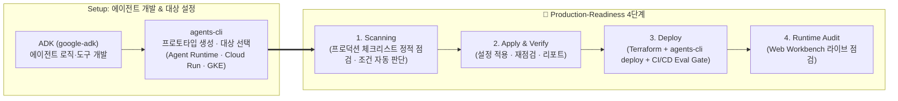

# 🛡️ Production Ready Agent Platform

<p align="center">
  <a href="#-한국어-가이드-korean"><strong>🇰🇷 한국어 가이드 (Korean)</strong></a> ·
  <a href="#-english-guide"><strong>🇺🇸 English Guide</strong></a>
</p>

---

<a id="-한국어-가이드-korean"></a>

# 🇰🇷 한국어 가이드 (Korean)

## 💡 한 줄 요약: 이 도구는 무엇인가요?
개발자가 로컬에서 만든 **AI 에이전트 프로토타입(`adk create` 또는 `agents-cli scaffold`)**을 스캔해, **`Agent Runtime` · `Cloud Run` · `GKE`** 환경별 (완전 관리형 ↔ 제어권·유연성 순) **프로덕션 체크리스트**로 프로덕션 준비 상태를 점검하고, 필요한 설정(`ADK 코드` · `Terraform` · `Kubernetes YAML` · `CI/CD 평가 게이트`)을 미리보기 후 적용해 주는 도구입니다.

### ✨ 프로덕션 체크리스트 핵심 원칙 (v4 · 4대 균형 범주 · 공통/고유 분리)
1. **에이전트 특성에서 나온 항목만 점검합니다** — 모든 항목은 "에이전트의 X 특성 때문에 Y를 해야 한다"로 설명되며, 모든 Check·Best Practice에 공식 문서 근거 링크가 포함됩니다.
2. **4대 균형 범주 · 31개 고유 항목 (중복 0건)**: `RS` (Runtime & State) · `ID` (Identity & Governance) · `SF` (Safety & Guardrails) · `DO` (Delivery, Eval & Observability). 전 환경 공통 6개(`COMMON-*`)와 런타임 고유 항목(`AR-*` 8 · `CR-*` 8 · `GKE-*` 9)을 분리했으며, 기존 v3(`CR-F1`, `AR-S3`, `GKE-O1`) 및 v2 `C*` ID는 별칭으로 100% 하위 호환됩니다.
3. **등급**: 필수 항목은 반드시 충족 / 조건부 항목(멀티턴 대화 · 장기 기억 필요 · AI 생성 코드 실행 · MCP·외부 도구 호출 · 유휴 일시정지·복원 · 사용자 대신 외부 도구 호출)은 조건이 해당할 때만 점검(아니면 N/A) / 🅿️ Preview 및 🧩 선택형 Add-on(BigQuery Agent Analytics · Model Armor · ADK Tool Confirmation HITL · Online Evaluation Monitor)은 판정을 막지 않고 사용자가 직접 선택할 때만 적용합니다.
4. **선택 적용 · 1개 Feature씩 순차 반영**: 전체 Best Practice를 먼저 진단·설명(Find)한 뒤 사용자가 고른 항목만 맞춤 설정을 질문하고 1개씩 diff 승인 → 적용합니다.
5. **기존 값은 바꾸지 않습니다** — CPU·메모리·인스턴스 수·GKE 클러스터 모드 같은 값과 아키텍처 선택은 권고 사항으로만 안내합니다.

> [!IMPORTANT]
> **일반 플랫폼 BP는 Google Cloud 플랫폼 Skill을 함께 사용하세요.** 헬스 프로브 · 멀티존/PDB · Terraform IaC · 알림 정책 · Non-Root · 사설 연결 · Pod Security Standards · 서비스 계정 키 미사용(Workload Identity Federation)처럼 모든 컨테이너 서비스에 해당하는 BP는 이 체크리스트에서 점검하지 않습니다. [google/skills · cloud](https://github.com/google/skills/tree/main/skills/cloud)의 플랫폼 Skill을 **함께 참조할 것을 적극 권장**합니다.
>
> | 환경 | 함께 참조할 Skill |
> | :--- | :--- |
> | Agent Runtime | `agent-platform-deploy` · `agent-platform-agent-registry` · `agent-platform-access-audit` · `agent-platform-alert-configuration` |
> | Cloud Run | `cloud-run-basics` · `cloud-run-alert-configuration` · `google-cicd-terraform` · `google-cloud-waf-security` |
> | GKE | `gke-productionize` · `gke-reliability` · `gke-workload-security` · `gke-workload-identity` · `gke-networking` · `gke-alert-configuration` |



---

## 🔍 무엇을 체크하고 어떻게 조치해 주나요? (통합 웹 포털 & 체크리스트)

프로토타입과 상용 환경의 차이(Gap)부터 환경별 체크리스트, 10단계 핸즈온 실습, 기존 ADK 에이전트용 Skill 가이드, 런타임 라이브 진단까지 **통합 웹 포털**로 제공됩니다:

- 🧭 **01 · 시스템 소개 발표 장표 (16:9 Keynote + Appendix · PDF 인쇄 지원)**: [`/deck` (`web/static/deck.html`)](web/static/deck.html) *(핵심 8장 발표 본편 + Appendix 10장 기술 상세)*
- 📋 **02 · 프로덕션 체크리스트 (Web UI)**: [`/checklist` (`web/static/checklist.html`)](web/static/checklist.html) *(환경별 보기: `/checklist?track=agent_runtime` · `/checklist?track=cloud_run` · `/checklist?track=gke`)*
- 🛠️ **03 · 핸즈온 실습 가이드 (Step 0~9)**: [`/lab` (`web/static/hands-on-lab.html`)](web/static/hands-on-lab.html) *(Optional Day-1 ADK 만들기: [`/adk-lab` (`web/static/adk-lab.html`)](web/static/adk-lab.html))*
- ✨ **Agent Skill 사용 가이드 & 추천 프롬프트 (기존 ADK 에이전트용)**: [`/guide` (`web/static/guide.html`)](web/static/guide.html) *(4단계 표준 프롬프트 · 내 조건 맞춤 프롬프트 생성기 · 상황별 레시피)*
- 🩺 **04 · 런타임 라이브 진단 위자드 (Zero-IAM JSON Paste)**: [`/workbench` (`web/static/index.html`)](web/static/index.html)
- 📄 **프로덕션 체크리스트 루브릭 (Skill 문서)**: [`skills/agent-production-readiness/references/checklist-rubric.md`](skills/agent-production-readiness/references/checklist-rubric.md)
- 📑 **프로덕션 체크리스트 정의서 (선정 기준 · 위임 BP · 권고 사항)**: [`docs/checklist-v3-spec.md`](docs/checklist-v3-spec.md)
- 🗂️ **항목 데이터 (Single Source of Truth)**: [`catalog_v3.json`](skills/agent-production-readiness/scripts/prod_ready/catalog_v3.json)

---

## 🧭 이미 만든 ADK 에이전트에 Agent Skill 적용하기 (사용 가이드 & 추천 프롬프트)

> 웹에서 환경별 명령어 자동 전환과 **내 조건 맞춤 프롬프트 생성기**를 쓰려면 [`/guide` (`web/static/guide.html`)](web/static/guide.html) 페이지를 이용하세요.

### 1. 사전 준비 (최초 1회 · 약 3분)

**① Google Agents CLI (`agents-cli`) 및 공식 Agents CLI Skill 설치**:
```bash
command -v uv >/dev/null 2>&1 || curl -LsSf https://astral.sh/uv/install.sh | sh
export PATH="$HOME/.local/bin:$PATH"
uv tool install google-agents-cli --upgrade
agents-cli setup --skip-auth
agents-cli --version
```

**② Antigravity 통합 플러그인 설치 (권장 · Antigravity & Antigravity CLI `agy` 전용)**:
단 한 줄로 **Agent Skill(`agent-production-readiness`) + 네이티브 슬래시 커맨드 4종(`/prod-ready-doctor`, `/prod-ready-scan`, `/prod-ready-fix`, `/prod-ready-report`) + 상시 가드레일 규칙(`rules/AGENTS.md`)**이 통합 설치됩니다.
```bash
agy plugin install https://github.com/kiwonilee/production-ready-agent-platform
agy plugin list
```
*(플러그인 없이 Standalone Skill 폴더만 수동 설치하려면:)*
```bash
rm -rf ~/.gemini/skills/agent-production-readiness && mkdir -p ~/.gemini/skills
curl -fsSL "https://github.com/kiwonilee/production-ready-agent-platform/archive/refs/heads/main.tar.gz" \
  | tar -xz -C ~/.gemini/skills/ --strip-components=2 production-ready-agent-platform-main/skills/agent-production-readiness
```

**③ 기존 ADK 프로젝트에 배포 구성(`deployment/`)이 없는 경우**:
순수 `adk create`나 직접 작성한 `app/agent.py`만 있는 프로젝트라면 `agents-cli scaffold enhance`로 배포 뼈대(Terraform · Cloud Build · Dockerfile)만 덧붙입니다. 기존 `app/agent.py`는 `Skipping (your code)`로 그대로 보존됩니다. *(이미 `deployment/`가 있다면 건너뜁니다.)*
```bash
cd <내-ADK-프로젝트-폴더>

# --deployment-target: agent_runtime | cloud_run | gke 중 선택
agents-cli scaffold enhance . \
  --deployment-target agent_runtime \
  --cicd-runner google_cloud_build \
  --region us-central1
```

### 2. Antigravity 슬래시 커맨드 기반 4단계 워크플로우

프로젝트 루트에서 **Antigravity** 또는 **Antigravity CLI (`agy`)** 를 열고 아래 슬래시 커맨드를 순서대로 실행하세요:

| 단계 | 슬래시 커맨드 | 동작 |
| :--- | :--- | :--- |
| **Step 0 · Preflight** | `/prod-ready-doctor` | `agents-cli` 및 대상 환경 Google Cloud 플랫폼 스킬(`google/skills`) 점검 · 동의 시 설치 |
| **Step 1 · Find** | `/prod-ready-scan` | 파일 수정 없이 v4(4대 범주 · 31개 고유 항목) 진단표 + 항목별 1줄 설명 · 공식 근거 링크 출력 |
| **Step 2 · Fix** | `/prod-ready-fix CR-RS1, CR-ID1, CR-DO1` | 선택한 항목을 **1개씩 순차 진행**: 맞춤 설정 질문 → 단일 `diff` 미리보기 → 승인 → 적용 |
| **Step 3 · Report** | `/prod-ready-report` | `uv.lock` 갱신 → 최종 재검사 → `READINESS_REPORT.md/.html` 생성 + 배포 · 플랫폼 스킬 안내 |

### 3. 상황별 추천 프롬프트 모음

- **① 배포 환경이 미정일 때 (환경 추천 + 즉시 진단)**
  ```text
  현재 ADK 프로젝트 코드를 분석해서 Agent Runtime, Cloud Run, GKE 중 어떤 배포 환경이 가장 적합한지 근거와 함께 추천해줘.
  그리고 추천한 환경을 기준으로 agent-production-readiness 스킬의 정적 진단(scan)을 수정 없이 바로 실행해서 표로 보여줘.
  ```
- **② 원샷 진단 (내 에이전트 조건을 이미 알고 있을 때)**
  ```text
  agent-production-readiness 스킬로 현재 ADK 프로젝트를 Cloud Run 기준으로 점검하고 변경점(diff)까지 보여줘.
  조건은 conv=true, memory=false, tools=true, code=false, delegated=false 로 적용해서 추가 질문 없이 바로 진행해줘.
  ```
- **③ Agent Runtime — Agent Identity + Agent Gateway 중심**
  ```text
  agent-production-readiness 스킬로 Agent Runtime 기준 진단 및 diff를 보여줘.
  - 신원은 전용 SA 대신 Agent Identity(AR-S1)를 우선 사용하고,
  - 외부 MCP 도구를 호출하므로 Agent Gateway(AR-S3)는 먼저 DRY_RUN 모드로 구성해줘.
  - 트레이스에 프롬프트 본문이 기록되지 않는지(AR-OB1)도 반드시 확인해줘.
  ```
- **④ GKE — 긴 응답 보호(180s) + AI 생성 코드 격리 (`Agent Substrate` / `Agent Sandbox`)**
  ```text
  agent-production-readiness 스킬로 GKE 기준 진단 및 diff를 보여줘.
  - 긴 스트리밍 응답 보호를 위해 terminationGracePeriodSeconds는 180초로 설정해줘(GKE-O1).
  - AI 생성 코드 실행과 유휴 일시정지·복원이 필요해 실행 패턴은 agent_substrate(GKE Standard 1.37 이상)로 적용해줘(GKE-S2, GKE-O2).
    (Autopilot이나 사이드카·Arm 노드가 필요하면 agent_sandbox 대안으로 안내해줘.)
  ```
- **⑤ 특정 항목만 부분 적용 — CI/CD 파이프라인 · 평가 게이트(`*-D1`, `*-D2`)만 추가**
  ```text
  agent-production-readiness 스킬로 전체 수정은 하지 말고,
  CI/CD 파이프라인과 평가 게이트(D1, D2)만 점검해줘.
  평가 점수 임계값(eval_threshold)은 4.0으로 설정해서 diff를 먼저 보여주고, 내가 승인하면 적용해줘.
  ```
- **⑥ 사용자 대신 Jira · GitHub 호출 (`delegated=true`) — auth manager 전환 가이드**
  ```text
  이 에이전트는 사용자 대신 GitHub와 Jira API를 호출해.
  agent-production-readiness 스킬로 delegated=true 조건을 포함해 Security & Governance 항목을 점검하고,
  코드나 환경변수에 정적 API 키·PAT가 남아있는지 확인한 뒤 Agent Identity auth manager(3-legged OAuth) 전환 가이드를 코드 예시와 함께 알려줘.
  ```

### 4. 수정 범위 요약

| 구분 | 대상 파일 / 영역 | 설명 |
| :--- | :--- | :--- |
| **🔒 절대 수정 안 함** | `app/agent.py` (프롬프트 · 도구 · 로직) | `scaffold enhance`와 스킬 `apply` 모두 에이전트 로직은 보존 |
| **🛠️ 자동 패치 가능** | `services.py` · `fast_api_app.py` · `pyproject.toml` · `Dockerfile` · `deployment/terraform/*.tf` · `deployment/k8s/*.yaml` · `tests/eval/` · `.cloudbuild/staging.yaml` | 항상 `diff` 검토 및 사용자 승인 후 적용 |
| **📋 안내 전용** | `*-D1` (CI/CD 생성) · `AR-S4` / `CR-S5` (코드 격리) · `AR-S5` / `CR-S6` / `GKE-S5` (사용자 위임 인증) | 상태 판정 및 설정 가이드 제공 (자동 덮어쓰기 없음) |
| **📚 플랫폼 Skill 위임** | 헬스 프로브 · PDB · 알림 · Non-Root · Direct VPC/PSC-I · NetworkPolicy · PSS · SA 키 미사용 | [google/skills · cloud](https://github.com/google/skills/tree/main/skills/cloud) 플랫폼 Skill과 병행 점검 |

---

## 🚀 실행 방법 요약 (Chat · Web UI · CLI)

### 방법 1️⃣: Antigravity / Antigravity CLI (`agy`) 통합 플러그인 설치 *(가장 추천)*
```bash
agy plugin install https://github.com/kiwonilee/production-ready-agent-platform
```

### 방법 2️⃣: 브라우저 **웹 화면(Workbench UI)** 띄우기
```bash
uv run prod-ready ui samples/02_cloud_run_agent --port 8090
```

### 방법 3️⃣: 터미널 **CLI 명령어(`prod-ready`)** 사용하기
```bash
# 0) 의존성 점검 (필수: agents-cli >= 1.5.0 + agents-cli Skill · 권장: 플랫폼 Skill — 설치 강력 권장)
uv run prod-ready doctor samples/04_gke_agent --target gke
uv run prod-ready doctor samples/04_gke_agent --target gke --install-platform-skills   # 동의 시에만 설치
uv run prod-ready demo samples/02_cloud_run_agent
uv run prod-ready demo samples/04_gke_agent --target gke
```

---
---

<a id="-english-guide"></a>

# 🇺🇸 English Guide

## 💡 What is this in one sentence?
This toolkit scans a local **ADK (`google-adk`)** / **`agents-cli`** agent project against the **Production-Readiness Checklist** for **Agent Runtime**, **Cloud Run**, and **GKE**, previews diffs, and applies production settings in place (ADK code, Terraform, Kubernetes YAML, CI/CD evaluation gate).

### Production-Readiness Checklist Principles (v4)
- **Agent characteristics only**: every item is justified as "because the agent has trait X, it must do Y" and includes official Google Cloud / ADK documentation references.
- **4 balanced categories · 31 unique items (zero duplication)**: `RS` (Runtime & State) · `ID` (Identity & Governance) · `SF` (Safety & Guardrails) · `DO` (Delivery, Eval & Observability), split into 6 cross-runtime Common items (`COMMON-*`) and runtime-specific items (`AR-*` 8 · `CR-*` 8 · `GKE-*` 9). Legacy v3 and `C*` IDs remain accepted as aliases.
- **Grades**: required items must pass; conditional items are evaluated only when applicable (else N/A); 🅿️ Preview and 🧩 Optional Add-on items (`COMMON-DO3`, `COMMON-SF1`, `COMMON-SF2`, `AR-DO2`) never block Production Ready and are opt-in only.
- **Delegated platform BPs**: probes, PDB, IaC, alerts, non-root, private networking, PSS, and Workload Identity Federation are delegated to Google Cloud platform skills at https://github.com/google/skills/tree/main/skills/cloud.

## 🧭 Using the Antigravity Plugin Package (`agy` & Antigravity)
Install the integrated plugin (Agent Skill + 4 native slash commands + lightweight `rules/AGENTS.md` guardrails) in one command:
```bash
agy plugin install https://github.com/kiwonilee/production-ready-agent-platform
```
Then open **Antigravity** or **`agy`** in your ADK project root:
1. **`/prod-ready-doctor`** — Preflight `agents-cli` and recommended `google/skills` platform skills.
2. **`/prod-ready-scan`** — Read-only v4 diagnostic table + 1-line explanations & official reference links.
3. **`/prod-ready-fix CR-RS1, CR-ID1, CR-DO1`** — Interactive feature-by-feature configure, diff preview, and apply.
4. **`/prod-ready-report`** — Refresh `uv.lock`, re-scan, export `READINESS_REPORT.md/.html`, and list deploy & platform skill next steps.

## 🚀 Quickstart
```bash
# Install integrated Antigravity Plugin directly from GitHub
agy plugin install https://github.com/kiwonilee/production-ready-agent-platform
agy plugin list

# Or run the interactive Web Workbench (includes 3-track /lab guide: Agent Runtime, Cloud Run, GKE)
uv run prod-ready ui samples/02_cloud_run_agent --port 8090

# Dependency preflight (required: agents-cli >= 1.5.0 + agents-cli skills; strongly recommended: platform skills)
uv run prod-ready doctor . --target gke            # add --install-platform-skills to install (explicit consent)
```
