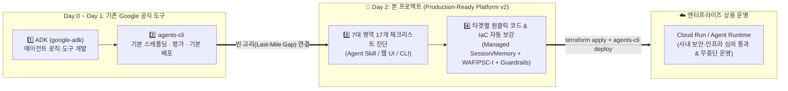

# 🛡️ Production-Ready Enterprise AI Agent Platform (v2)

<p align="center">
  <a href="#-한국어-가이드-korean"><strong>🇰🇷 한국어 가이드 (Korean)</strong></a> ·
  <a href="#-english-guide"><strong>🇺🇸 English Guide</strong></a>
</p>

---

<a id="-한국어-가이드-korean"></a>

# 🇰🇷 한국어 가이드 (Korean)

## 💡 한 줄 요약: 이 도구는 무엇인가요?
개발자가 로컬에서 만든 **AI 에이전트 프로토타입(`adk create` 또는 `agents-cli scaffold`)**을 스캔하여, **`Agent Runtime`과 `Cloud Run` 각 타겟의 아키텍처 특성에 맞춰 엔터프라이즈 상용 수준(Production-Ready)으로 배포할 수 있도록 7대 영역 · 17가지 핵심 보안·네트워크·세션·관측성·비용·품질 설정(`Terraform` + `ADK 플러그인`)을 진단하고 자동으로 보강(Hardening)해 주는 도구**입니다.

### ✨ v2 핵심 설계 원칙
1. **컴퓨트 사이징 강제 상향 금지**: 에이전트 부하 특성을 모른 채 `cpu`/`memory`/`concurrency`/`min_instances`를 임의로 올리지 않습니다. 기존 값을 그대로 보존하고, 부하 테스트(`Locust`) 기반 조정 권고(`Advisory`)만 비감점으로 안내합니다.
2. **D2 Managed-First 원칙**: 멀티턴 세션(`C2.1`)과 장기 기억(`C2.2`)은 운영 부담이 없는 **Agent Platform Managed Sessions (`VertexAiSessionService`) & Memory Bank (`VertexAiMemoryBankService`)** 를 기본으로 구성합니다. *(규제·기존 인프라 재사용 시 Self-Hosted Cloud SQL / Redis / Vector DB도 별도 옵션으로 선택 가능)*
3. **`Cloud Run` vs `Agent Runtime` 엄격 분리**: `Agent Runtime`은 6개 플랫폼 내장 항목(`C1.1, C1.2, C2.1, C3.2, C5.1, C7.2`)을 `MANAGED_NATIVE`로 자동 처리하고 `ReasoningEngine` 전용 메트릭·PSC-I만 적용하며, `Cloud Run`은 Direct VPC Egress · Serverless NEG + Cloud Armor WAF(또는 `internal_iap`) · 카나리 롤백 스크립트를 구성합니다.

---

## 🎯 왜 이 프로젝트가 필요한가요? (배경 및 목적)

1. **프로토타입(Day-1)과 엔터프라이즈 상용화(Day-2) 사이의 공백 해소**:
   - **ADK (`google-adk`)**로 에이전트 로직을 빠르게 만들고, **`agents-cli` (`google-agents-cli`)**로 기본 스캐폴딩·평가·배포를 수행할 수 있습니다.
   - 하지만 실제 기업 상용 오픈을 위해서는 **사내 폐쇄망 연동, 영속 세션/장기기억, 프롬프트 인젝션·PII·SSRF 차단, Non-Root 컨테이너 보안, 턴별 루프/토큰 상한, 타겟별 SRE 알람, 공식 Eval 품질 게이트**가 필수입니다.
2. **플랫폼 간 Production-Ready 격차 해소 (`Cloud Run` vs `Agent Runtime`)**:
   - **Agent Runtime**은 6개 런타임/세션/인그레스/트레이싱 영역을 플랫폼이 기본 제공하는 반면, **Cloud Run**에서는 이를 코드와 Terraform으로 직접 구성해야 합니다.
   - 본 프로젝트는 **7대 영역 · 17개 표준 체크리스트(`C1.1`~`C7.2`)**로 양 플랫폼 모두에서 **100% Production-Ready** 상태에 도달할 수 있게 해줍니다.



---

## 🔍 무엇을 체크하고 어떻게 조치해 주나요? (7대 영역 · 17개 핵심 항목 상세)

### 1️⃣ 런타임 & 헬스체크 (Runtime & Scaling — 가중치 `2x`)
> 💡 **사이징 정책**: `cpu`, `memory`, `concurrency`, `min_instances`는 강제 상향하지 않으며 `Locust` 부하 테스트 권고(`Advisory`)로만 안내합니다.

| ID | 점검 항목 | Cloud Run (`cloud_run`) | Agent Runtime (`agent_runtime`) | 생성/수정 파일 |
| :---: | :--- | :--- | :--- | :--- |
| **`C1.1`** | **런타임 IaC 선언** | `agents-cli` v1.5.0 호환 `google_cloud_run_v2_service.app` 선언/유지 | 🟢 **MANAGED_NATIVE** (`google_vertex_ai_reasoning_engine.app`) | `deployment/terraform/service.tf` |
| **`C1.2`** | **헬스 프로브 & Startup CPU Boost** | `/list-apps:8080` 대상 `startup_probe` · `liveness_probe` + `startup_cpu_boost = true` 추가 *(기존 CPU/메모리/min_instances 보존)* | 🟢 **MANAGED_NATIVE** (플랫폼 내장 헬스체크 & 라이프사이클) | `deployment/terraform/service.tf`, `app/fast_api_app.py` |

### 2️⃣ 세션 & 장기 기억 영속성 (Session & Memory — 가중치 `2x`)
> 💡 **Managed-First 기본 제공**: 별도 DB 운영 부담이 없는 **Agent Platform Managed Sessions & Memory Bank**를 기본 연결합니다. *(규제·기존 인프라 재사용 시 Self-Hosted Cloud SQL / Memorystore Redis / Vector DB도 별도 옵션으로 구성 가능)*

| ID | 점검 항목 | Cloud Run (`cloud_run`) | Agent Runtime (`agent_runtime`) | 생성/수정 파일 |
| :---: | :--- | :--- | :--- | :--- |
| **`C2.1`** | **멀티턴 영구 세션 (Managed Sessions)** | `InMemorySessionService` 제거 → **`VertexAiSessionService`** + `GOOGLE_CLOUD_AGENT_ENGINE_ID` 연동 *(Self-Hosted DB는 참고 옵션)* | 🟢 **MANAGED_NATIVE** (플랫폼 내장 Managed Session Service) | `app/app_utils/services.py`, `app/fast_api_app.py`, `deployment/terraform/service.tf` |
| **`C2.2`** | **크로스-세션 장기 기억 (Memory Bank)** | **`VertexAiMemoryBankService`** (`shared://memory`) + `after_agent_callback` (`auto_save_session_to_memory`) 장착 | Cloud Run과 동일 (`VertexAiMemoryBankService` + 자동 저장 콜백) | `app/app_utils/services.py`, `app/agent.py`, `app/fast_api_app.py` |
| **`C2.3`** | **GCS 아티팩트/로그 버킷 내구성** | `logs_data_bucket`에 **Object Versioning** + **7일 Soft Delete** 정책 활성화 | Cloud Run과 동일 (`storage.tf`) | `deployment/terraform/storage.tf` |

### 3️⃣ 사내망 네트워크 & 엣지 보안 (Private Networking & Edge — 가중치 `2x`)
| ID | 점검 항목 | Cloud Run (`cloud_run`) | Agent Runtime (`agent_runtime`) | 생성/수정 파일 |
| :---: | :--- | :--- | :--- | :--- |
| **`C3.1`** | **프라이빗 아웃바운드 & PGA** *(구 C3.3 통합)* | `Direct VPC Egress (PRIVATE_RANGES_ONLY)` + `/26` 서브넷 (`private_ip_google_access = true`, `var.vpc_network_name`) | `PSC Interface (google_compute_network_attachment)` 생성 후 `service.tf` `psc_interface_config`에 직접 연결 + `/28` PGA 서브넷 | `deployment/terraform/service.tf`, `deployment/terraform/production_ready.tf`, `variables.tf` |
| **`C3.2`** | **제로트러스트 인그레스 & WAF/IAP** | **`external_waf`**: `INTERNAL_LOAD_BALANCER` + `default_uri_disabled` + Serverless NEG + Cloud Armor WAF<br/>**`internal_iap`**: `INGRESS_TRAFFIC_INTERNAL_ONLY` / IAP SSO | 🟢 **MANAGED_NATIVE** (퍼블릭 무인증 URL 미노출 · IAM 인증 전용) | `deployment/terraform/service.tf`, `deployment/terraform/production_ready.tf` |

### 4️⃣ 보안, 최소 권한 & 가드레일 (Security & Guardrails — 가중치 `3x`)
| ID | 점검 항목 | Cloud Run (`cloud_run`) | Agent Runtime (`agent_runtime`) | 생성/수정 파일 |
| :---: | :--- | :--- | :--- | :--- |
| **`C4.1`** | **최소 권한 SA · 삭제보호 · Secret 고정** | `roles/storage.admin` → **`roles/storage.objectUser`** 축소, `deletion_protection = true`, Secret 버전 고정 | `roles/storage.objectUser` 축소 + 불필요한 `roles/cloudsql.client` 제거 | `deployment/terraform/variables.tf`, `deployment/terraform/service.tf` |
| **`C4.2`** | **Model Armor API & 도구 SSRF/IDOR** *(구 C4.4 통합)* | 실제 **`google.cloud.modelarmor_v1` API** (`sanitize_user_prompt`/`sanitize_model_response`) + 로컬 PII/인젝션 폴백 + `before_tool_callback` SSRF(`169.254.169.254`)/`user_id` IDOR 검증 | Cloud Run과 동일 (`ModelArmorGuardrailPlugin` 장착) | `app/app_utils/model_armor_plugin.py`, `app/agent.py`, `deployment/terraform/service.tf` |
| **`C4.3`** | **컨테이너 Non-Root & Gen2 샌드박스** | `Dockerfile` **`USER 10001:10001`** + Cloud Run **`EXECUTION_ENVIRONMENT_GEN2`** | `Dockerfile` **`USER 10001:10001`** | `Dockerfile`, `deployment/terraform/service.tf` |

### 5️⃣ 관측성, 프라이버시 & 타겟별 SRE 알람 (Observability & Alerts — 가중치 `1x`)
| ID | 점검 항목 | Cloud Run (`cloud_run`) | Agent Runtime (`agent_runtime`) | 생성/수정 파일 |
| :---: | :--- | :--- | :--- | :--- |
| **`C5.1`** | **OpenTelemetry GenAI 분산 트레이싱** | `OTEL_SEMCONV_STABILITY_OPT_IN="gen_ai_latest_experimental"` + `otel_to_cloud = True` | 🟢 **MANAGED_NATIVE** (`GOOGLE_CLOUD_AGENT_ENGINE_ENABLE_TELEMETRY="true"`) | `deployment/terraform/service.tf`, `app/fast_api_app.py` |
| **`C5.2`** | **`NO_CONTENT` 프라이버시 & Opt-In BQ** | `OTEL_INSTRUMENTATION_GENAI_CAPTURE_MESSAGE_CONTENT="NO_CONTENT"` + `ADK_CAPTURE_MESSAGE_CONTENT_IN_SPANS="false"` *(선택: `enable_bq_analytics=true` 시 `US` 리전 BQ 플러그인)* | Cloud Run과 동일 (`service.tf` 환경변수 + 선택적 BQ 플러그인) | `deployment/terraform/service.tf`, `app/agent.py` |
| **`C5.3`** | **타겟별 SRE 골든 시그널 알람** | `cloud_run_revision` P95 지연(`> 15s`) · **PromQL 5xx 비율(`> 2%`)** · Guardrail 차단 급증 알럿 | **`aiplatform.googleapis.com/ReasoningEngine`** 전용 지연/에러 메트릭 + Guardrail 알럿 | `deployment/terraform/alerts.tf` |

### 6️⃣ FinOps 비용 통제 & 쿼터 회복력 (FinOps & Resilience — 가중치 `1x`)
| ID | 점검 항목 | Cloud Run (`cloud_run`) | Agent Runtime (`agent_runtime`) | 생성/수정 파일 |
| :---: | :--- | :--- | :--- | :--- |
| **`C6.1`** | **턴별 루프 상한 · 출력 토큰 캡 & 예산** | `invocation_id` 기반 턴별 카운터 리셋 + `llm_request.config.max_output_tokens` 실제 적용 (`CostTokenGuardrailPlugin`) + 선택적 `budget.tf` | Cloud Run과 동일 | `app/app_utils/cost_guard_plugin.py`, `app/agent.py`, `deployment/terraform/budget.tf` |
| **`C6.2`** | **429 DSQ 쿼터 방어 & 지수 백오프** | `HttpRetryOptions(attempts=5, initial_delay=1.0, exp_base=2.0)` + `GOOGLE_CLOUD_LOCATION` (`"global"` 또는 레지던시 리전) | Cloud Run과 동일 | `app/agent.py`, `deployment/terraform/service.tf` |

### 7️⃣ CI/CD 공식 품질 게이트 & 무중단 롤백 (CI/CD & Eval Gate — 가중치 `2x`)
| ID | 점검 항목 | Cloud Run (`cloud_run`) | Agent Runtime (`agent_runtime`) | 생성/수정 파일 |
| :---: | :--- | :--- | :--- | :--- |
| **`C7.1`** | **공식 `agents-cli eval run` 품질 게이트** | `.cloudbuild/staging.yaml`에 공식 `uvx google-agents-cli eval run --dataset ... --metrics ...` + `tests/eval/eval_config.yaml` + `smoke_dataset.json` 추가 | Cloud Run과 동일 | `.cloudbuild/staging.yaml`, `tests/eval/eval_config.yaml`, `tests/eval/datasets/smoke_dataset.json` |
| **`C7.2`** | **무중단 카나리 배포 & 안전 롤백** | `lifecycle.ignore_changes` + `scripts/canary_rollout.sh` (`10→50→100%`, **`$PREVIOUS_REVISION` 안전 복원**) | 🟢 **MANAGED_NATIVE** (`lifecycle.ignore_changes` 보존; Cloud Run 카나리 스크립트 미생성) | `deployment/terraform/service.tf`, `scripts/canary_rollout.sh` *(Cloud Run 전용)* |

---

## 📦 사전 준비 및 필수 CLI 설치 (Prerequisites & Setup)

| 구분 | 필요한 도구 | 언제 필요한가요? | 설치 및 초기 설정 명령어 |
| :--- | :--- | :--- | :--- |
| **필수 (공통)** | **`Python 3.10+` & [`uv`](https://docs.astral.sh/uv/)** | 로컬 진단(`scan`), 패치(`apply`), 웹 워크벤치(`ui`) 및 `agents-cli` 실행 시 필수 | `curl -LsSf https://astral.sh/uv/install.sh \| sh` |
| **권장 (에이전트 생성 & 배포)** | **[`google-agents-cli`](https://github.com/google/agents-cli) (`agents-cli` v1.5.0+)** | 신규 ADK 에이전트 스캐폴딩(`agents-cli scaffold`), 품질 평가(`eval run`), GCP 배포(`deploy`) 시 사용 | `uv tool install "google-agents-cli~=1.5.0"`<br/>`uvx google-agents-cli setup`<br/>`agents-cli info` |
| **선택 (방법 1️⃣ 사용 시)** | **[Antigravity IDE / CLI](https://antigravity.google/)**<br/>*(또는 Gemini CLI, Claude Code)* | **방법 1️⃣(채팅으로 진단·패치)** 사용 시 필요 | `mkdir -p ~/.gemini/skills`<br/>`cp -r skills/agent-production-readiness ~/.gemini/skills/` |
| **선택 (실제 GCP 배포 시)** | **[`gcloud` CLI](https://cloud.google.com/sdk/docs/install) & [`Terraform >= 1.5`](https://developer.hashicorp.com/terraform/install)** | 로컬 패치(100점 달성) 완료 후 실제 Google Cloud에 배포할 때만 필요 | `gcloud auth login`<br/>`gcloud auth application-default login`<br/>`gcloud config set project 내_GCP_프로젝트_ID` |

---

## 🚀 어떻게 사용하나요? (3가지 방법 중 편한 방법 선택)

### 방법 1️⃣: Antigravity (또는 Gemini CLI)에서 **채팅으로** 사용하기 *(가장 추천)*
1. **내 컴퓨터에 스킬 복사하기 (최초 1회)**:
   ```bash
   mkdir -p ~/.gemini/skills
   cp -r skills/agent-production-readiness ~/.gemini/skills/agent-production-readiness
   ```
2. **내가 개발 중인 에이전트 폴더를 열고 채팅창에 말하기**:
   - 💬 *"이 에이전트 프로덕션 준비 점수가 몇 점인지 스캔해줘"* *(먼저 3개 프로필 + 직접 맞춤 조합 중 선택 후 진단 진행)*
   - 💬 *"부족한 항목들 Diff 보여주고 전부 적용해줘"*
   - 💬 *"보안성 심의 제출용 리포트(`READINESS_REPORT.md` / `.html`) 만들어줘"*

### 방법 2️⃣: 브라우저 **웹 화면(Workbench UI)**을 띄워서 마우스 클릭으로 사용하기
```bash
uv run prod-ready ui samples/02_cloud_run_agent --port 8090
```
브라우저에서 **`http://127.0.0.1:8090`**을 열면 **17개 체크포인트 진단**, **4대 모의 공격 시뮬레이션**, **실시간 Diff 미리보기**, **원클릭 적용**, **HTML 심의 성적표 발급**, 그리고 **`/lab` 핸즈온 가이드**까지 한 번에 확인할 수 있습니다.

### 방법 3️⃣: 터미널에서 **명령어(`prod-ready`)**로 빠르게 사용하기
```bash
# 🎬 4단계 Before -> Patch -> After -> Report 라이브 데모
uv run prod-ready demo samples/02_cloud_run_agent

# 개별 실행 예시
uv run prod-ready scan samples/02_cloud_run_agent --items ALL
uv run prod-ready simulate samples/02_cloud_run_agent --items ALL
uv run prod-ready diff samples/02_cloud_run_agent --items ALL --params '{"ingress_mode":"internal_iap"}'
uv run prod-ready apply samples/02_cloud_run_agent --items ALL --params '{"ingress_mode":"internal_iap"}'
uv run prod-ready report samples/02_cloud_run_agent --items ALL -o READINESS_REPORT.md
uv run prod-ready reset samples/02_cloud_run_agent
```

---
---

<a id="-english-guide"></a>

# 🇺🇸 English Guide

## 💡 What is this in one sentence?
This toolkit bridges the **Day-2 Production Readiness Gap** after **ADK (`google-adk`)** and **`agents-cli` (`google-agents-cli`)**: it scans your local agent project against a **streamlined 7-Domain, 17-Item Enterprise Production Checklist (`C1.1`–`C7.2`, v2)** with strict runtime differentiation between **Cloud Run** and **Agent Runtime**, and **automatically patches your Terraform and Python ADK code in-place**.

### Key v2 Engineering Principles
- **Zero Unsolicited Compute Upsizing**: Existing `cpu`, `memory`, `concurrency`, and `min_instances` are preserved untouched; non-scoring Locust load-test advisories guide right-sizing instead.
- **Managed-First Session & Memory (`D2`)**: Wires **Agent Platform Managed Sessions (`VertexAiSessionService`)** and **Memory Bank (`VertexAiMemoryBankService`)** by default *(with Self-Hosted Cloud SQL / Redis / Vector DB noted briefly as an optional alternative)*.
- **Strict Target Separation (`cloud_run` vs `agent_runtime`)**: 6 platform-managed items (`C1.1`, `C1.2`, `C2.1`, `C3.2`, `C5.1`, `C7.2`) are `MANAGED_NATIVE` on Agent Runtime; `alerts.tf` uses `ReasoningEngine` metrics vs Cloud Run PromQL 5xx ratio; `psc_interface_config` is wired directly into `service.tf`; Cloud Run canary rollback restores `$PREVIOUS_REVISION` (and is never generated on Agent Runtime).

## 🔍 7 Domains · 17 Core Checklist Items (`C1.1`–`C7.2`)

| ID | Domain | Cloud Run (`cloud_run`) | Agent Runtime (`agent_runtime`) | Target Files |
| :---: | :--- | :--- | :--- | :--- |
| **`C1.1`** | Runtime | `google_cloud_run_v2_service.app` IaC declaration | 🟢 `MANAGED_NATIVE` (`google_vertex_ai_reasoning_engine.app`) | `deployment/terraform/service.tf` |
| **`C1.2`** | Runtime | `startup_probe` & `liveness_probe` (`/list-apps:8080`) + `startup_cpu_boost=true` *(sizing preserved)* | 🟢 `MANAGED_NATIVE` (platform health probes) | `deployment/terraform/service.tf`, `app/fast_api_app.py` |
| **`C2.1`** | Session | **Managed**: `VertexAiSessionService` + `GOOGLE_CLOUD_AGENT_ENGINE_ID` *(Optional self-hosted DB)* | 🟢 `MANAGED_NATIVE` (built-in session service) | `app/app_utils/services.py`, `app/fast_api_app.py`, `service.tf` |
| **`C2.2`** | Session | **Managed**: `VertexAiMemoryBankService` (`shared://memory`) + `after_agent_callback` | Same (`VertexAiMemoryBankService` + auto-save callback) | `app/app_utils/services.py`, `app/agent.py`, `fast_api_app.py` |
| **`C2.3`** | Session | GCS `logs_data_bucket` Object `versioning` + 7-day `soft_delete_policy` | Same | `deployment/terraform/storage.tf` |
| **`C3.1`** | Network | Direct VPC Egress (`PRIVATE_RANGES_ONLY`) + `/26` PGA subnet (`var.vpc_network_name`) | PSC Interface (`google_compute_network_attachment`) wired to `psc_interface_config` + `/28` PGA subnet | `service.tf`, `production_ready.tf`, `variables.tf` |
| **`C3.2`** | Network | `external_waf` (LB + Serverless NEG + Cloud Armor WAF + `default_uri_disabled`) OR `internal_iap` (`INTERNAL_ONLY`) | 🟢 `MANAGED_NATIVE` (IAM-only endpoint) | `service.tf`, `production_ready.tf` |
| **`C4.1`** | Security | `roles/storage.objectUser`, `deletion_protection=true`, pinned Secret version | `roles/storage.objectUser`, strip unused `cloudsql.client` | `variables.tf`, `service.tf` |
| **`C4.2`** | Security | `ModelArmorGuardrailPlugin` (`google.cloud.modelarmor_v1` + PII fallback + `before_tool_callback` SSRF/IDOR) | Same | `app/app_utils/model_armor_plugin.py`, `app/agent.py`, `service.tf` |
| **`C4.3`** | Security | Non-root `USER 10001:10001` + `EXECUTION_ENVIRONMENT_GEN2` | Non-root `USER 10001:10001` | `Dockerfile`, `service.tf` |
| **`C5.1`** | Observability | `OTEL_SEMCONV_STABILITY_OPT_IN` + `otel_to_cloud=True` | 🟢 `MANAGED_NATIVE` (`ENABLE_TELEMETRY=true`) | `service.tf`, `app/fast_api_app.py` |
| **`C5.2`** | Observability | `NO_CONTENT` + `ADK_CAPTURE_MESSAGE_CONTENT_IN_SPANS=false` (+ opt-in `BigQueryAgentAnalyticsPlugin` in `US`) | Same | `service.tf`, `app/agent.py` |
| **`C5.3`** | Observability | Cloud Run P95 latency (`15s`) + PromQL 5xx ratio (`>2%`) + Guardrail alerts | `ReasoningEngine` metrics + Guardrail alerts | `deployment/terraform/alerts.tf` |
| **`C6.1`** | FinOps | Per-turn `invocation_id` reset + `max_output_tokens` (`CostTokenGuardrailPlugin`) + optional `budget.tf` | Same | `app/app_utils/cost_guard_plugin.py`, `app/agent.py`, `budget.tf` |
| **`C6.2`** | FinOps | `HttpRetryOptions(attempts=5)` + `GOOGLE_CLOUD_LOCATION` (`global` or regional residency) | Same | `app/agent.py`, `service.tf` |
| **`C7.1`** | CI/CD | Official `uvx google-agents-cli eval run --dataset ... --metrics ...` + `eval_config.yaml` + `smoke_dataset.json` | Same | `.cloudbuild/staging.yaml`, `tests/eval/...` |
| **`C7.2`** | CI/CD | `lifecycle.ignore_changes` + `scripts/canary_rollout.sh` (rolls back to `$PREVIOUS_REVISION`) | 🟢 `MANAGED_NATIVE` (`ignore_changes`; no Cloud Run script) | `service.tf`, `scripts/canary_rollout.sh` |

## 🚀 Quickstart
```bash
# Install skill for Antigravity / Gemini CLI
mkdir -p ~/.gemini/skills && cp -r skills/agent-production-readiness ~/.gemini/skills/agent-production-readiness

# Or run the interactive 3-pane Web Workbench (includes /lab guide)
uv run prod-ready ui samples/02_cloud_run_agent --port 8090

# Or run CLI commands directly
uv run prod-ready demo samples/02_cloud_run_agent
```
