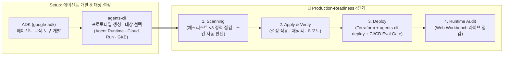

# 🛡️ Production-Ready Enterprise AI Agent Platform (Checklist v3)

<p align="center">
  <a href="#-한국어-가이드-korean"><strong>🇰🇷 한국어 가이드 (Korean)</strong></a> ·
  <a href="#-english-guide"><strong>🇺🇸 English Guide</strong></a>
</p>

---

<a id="-한국어-가이드-korean"></a>

# 🇰🇷 한국어 가이드 (Korean)

## 💡 한 줄 요약: 이 도구는 무엇인가요?
개발자가 로컬에서 만든 **AI 에이전트 프로토타입(`adk create` 또는 `agents-cli scaffold`)**을 스캔해, **`Agent Runtime` · `Cloud Run` · `GKE`** 환경별 (완전 관리형 ↔ 제어권·유연성 순) **체크리스트 v3**로 프로덕션 준비 상태를 점검하고, 필요한 설정(`ADK 코드` · `Terraform` · `Kubernetes YAML` · `CI/CD 평가 게이트`)을 미리보기 후 적용해 주는 도구입니다.

### ✨ 체크리스트 v3 핵심 원칙
1. **에이전트 특성에서 나온 항목만 점검합니다** — 모든 항목은 "에이전트의 X 특성 때문에 Y를 해야 한다"로 설명됩니다. (예: 대화 상태 → 관리형 영속 세션 저장, LLM 비결정성 → 평가 데이터셋 · 평가 게이트, 자율적 도구 호출 → 에이전트 전용 신원 · Agent Gateway, 사용자 대신 행동 → 사용자 위임 인증 (Agent Identity auth manager), AI 생성 코드 → Agent Substrate on GKE)
2. **5개 범주**: Features · Optimize · Delivery & Eval · Observability · Security. ID는 `<환경>-<범주><번호>` (예: `CR-F1`, `AR-S3`, `GKE-O1`). 항목 수는 Agent Runtime 10 · Cloud Run 11 · GKE 12개입니다. 기존 `C*` ID는 별칭으로 계속 동작합니다.
3. **등급**: 필수 항목은 반드시 충족 / 조건부 항목(멀티턴 대화 · 장기 기억 필요 · AI 생성 코드 실행 · MCP·외부 도구 호출 · 자주 일시정지·재개하는 상태 유지형 에이전트 · 사용자 대신 외부 도구 호출)은 조건이 해당할 때만 점검(아니면 N/A) / 🅿️ Preview 항목(Agent Registry · Agent Gateway · 사용자 위임 인증 등)은 표시만 하고 Production Ready 판정을 막지 않습니다.
4. **조건은 코드에서 먼저 자동 판단**하고, 판단하지 못한 것만 사용자에게 묻습니다.
5. **기존 값은 바꾸지 않습니다** — CPU·메모리·인스턴스 수·GKE 클러스터 모드 같은 값과 비용이 드는 선택형 제품(Model Armor, Cloud Armor, Secure Web Proxy 등)은 권고 사항으로만 안내합니다.

> [!IMPORTANT]
> **일반 플랫폼 BP는 Google Cloud 플랫폼 Skill을 함께 사용하세요.** 헬스 프로브 · 멀티존/PDB · Terraform IaC · 알림 정책 · Non-Root · 사설 연결 · Pod Security Standards · 서비스 계정 키 미사용(Workload Identity Federation)처럼 모든 컨테이너 서비스에 해당하는 BP는 이 체크리스트에서 점검하지 않습니다. [google/skills · cloud](https://github.com/google/skills/tree/main/skills/cloud)의 플랫폼 Skill을 **함께 참조할 것을 적극 권장**합니다.
>
> | 환경 | 함께 참조할 Skill |
> | :--- | :--- |
> | Agent Runtime | `agent-platform-deploy` · `agent-platform-agent-registry` · `agent-platform-access-audit` · `agent-platform-alert-configuration` |
> | Cloud Run | `cloud-run-basics` · `cloud-run-alert-configuration` · `google-cicd-terraform` · `google-cloud-waf-security` |
> | GKE | `gke-productionize` · `gke-reliability` · `gke-workload-security` · `gke-workload-identity` · `gke-networking` · `gke-alert-configuration` |



---

## 🔍 무엇을 체크하고 어떻게 조치해 주나요? (4단계 통합 웹 포털 & 체크리스트)

프로토타입과 상용 환경의 차이(Gap)부터 환경별 체크리스트, 11단계 핸즈온 실습, 런타임 라이브 진단까지 **4단계 통합 웹 포털**로 제공됩니다:

- 🧭 **01 · 시스템 소개 발표 장표 (16:9 13 Slides · PDF 인쇄 지원)**: [`/deck` (`web/static/deck.html`)](web/static/deck.html) *(도입 필요성, Prototype vs. Production, 환경별 점검 차이·특화 기능·장단점 비교)*
- 📋 **02 · 체크리스트 v3 (Web UI)**: [`/checklist` (`web/static/checklist.html`)](web/static/checklist.html) *(환경별 보기: `/checklist?track=agent_runtime` · `/checklist?track=cloud_run` · `/checklist?track=gke`)*
- 🛠️ **03 · 핸즈온 실습 가이드 (Step 0~10)**: [`/lab` (`web/static/hands-on-lab.html`)](web/static/hands-on-lab.html)
- 🩺 **04 · 런타임 라이브 진단 위자드 (Zero-IAM JSON Paste)**: [`/workbench` (`web/static/index.html`)](web/static/index.html)
- 📄 **체크리스트 v3 루브릭 (Skill 문서)**: [`skills/agent-production-readiness/references/checklist-rubric.md`](skills/agent-production-readiness/references/checklist-rubric.md)
- 📑 **체크리스트 v3 정의서 (선정 기준 · 위임 BP · 권고 사항)**: [`docs/checklist-v3-spec.md`](docs/checklist-v3-spec.md)
- 🗂️ **항목 데이터 (Single Source of Truth)**: [`catalog_v3.json`](skills/agent-production-readiness/scripts/prod_ready/catalog_v3.json)

---

## 🚀 어떻게 사용하나요?

### 방법 1️⃣: Antigravity (또는 Gemini CLI)에서 **채팅으로** 사용하기 *(가장 추천)*
```bash
rm -rf ~/.gemini/skills/agent-production-readiness && mkdir -p ~/.gemini/skills
curl -fsSL "https://github.com/kiwonilee/production-ready-agent-platform/archive/refs/heads/main.tar.gz" | tar -xz -C ~/.gemini/skills/ --strip-components=2 production-ready-agent-platform-main/skills/agent-production-readiness
```

### 방법 2️⃣: 브라우저 **웹 화면(Workbench UI)** 띄우기
```bash
uv run prod-ready ui samples/02_cloud_run_agent --port 8090
```

### 방법 3️⃣: 터미널 **CLI 명령어(`prod-ready`)** 사용하기
```bash
# 0) 의존성 점검 (필수: agents-cli >= 1.5.0 + agents-cli Skill · 권장: 플랫폼 Skill — 설치 강력 권장)
uv run prod-ready doctor samples/04_gke_agent --target gke
uv run prod-ready doctor samples/04_gke_agent --target gke --install-platform-skills   # 동의 시에만 설치
uv run prod-ready demo samples/02_cloud_run_agent
uv run prod-ready demo samples/04_gke_agent --target gke
```

---
---

<a id="-english-guide"></a>

# 🇺🇸 English Guide

## 💡 What is this in one sentence?
This toolkit scans a local **ADK (`google-adk`)** / **`agents-cli`** agent project against **checklist v3** for **Agent Runtime**, **Cloud Run**, and **GKE**, previews diffs, and applies production settings in place (ADK code, Terraform, Kubernetes YAML, CI/CD evaluation gate).

### Checklist v3 Principles
- **Agent characteristics only**: every item is justified as "because the agent has trait X, it must do Y" (conversation state → persistent session, LLM non-determinism → CI/CD eval gate, autonomous tool calls → dedicated identity & Agent Gateway, acting on behalf of users → user-delegated auth (Agent Identity auth manager), AI-generated code → Agent Substrate on GKE).
- **5 categories** (Features · Optimize · Delivery & Eval · Observability · Security); IDs like `CR-F1`, `AR-S3`, `GKE-O1`; Agent Runtime 10 · Cloud Run 11 · GKE 12 items; legacy `C*` IDs are accepted as aliases.
- **Grades**: required items must pass; conditional items (multi-turn conversation, long-term memory, AI-generated code execution, MCP/external tool calls, long-idle conversational agents, tools called on behalf of users) are evaluated only when the condition applies (else N/A); 🅿️ Preview items are reported but never block Production Ready.
- **Delegated platform BPs**: probes, PDB, IaC, alerts, non-root, private networking, PSS, and no service-account keys (Workload Identity Federation) are not checked here — **strongly recommended: also use the Google Cloud platform skills** at https://github.com/google/skills/tree/main/skills/cloud.
- See [`/checklist`](web/static/checklist.html), [`checklist-rubric.md`](skills/agent-production-readiness/references/checklist-rubric.md), and [`docs/checklist-v3-spec.md`](docs/checklist-v3-spec.md).

## 🚀 Quickstart
```bash
# Install skill directly from GitHub for Antigravity / Gemini CLI
rm -rf ~/.gemini/skills/agent-production-readiness && mkdir -p ~/.gemini/skills
curl -fsSL "https://github.com/kiwonilee/production-ready-agent-platform/archive/refs/heads/main.tar.gz" | tar -xz -C ~/.gemini/skills/ --strip-components=2 production-ready-agent-platform-main/skills/agent-production-readiness

# Or run the interactive Web Workbench (includes 3-track /lab guide: Agent Runtime, Cloud Run, GKE)
uv run prod-ready ui samples/02_cloud_run_agent --port 8090

# Dependency preflight (required: agents-cli >= 1.5.0 + agents-cli skills; strongly recommended: platform skills)
uv run prod-ready doctor . --target gke            # add --install-platform-skills to install (explicit consent)

# Or run CLI commands directly (Cloud Run or GKE)
uv run prod-ready demo samples/02_cloud_run_agent
uv run prod-ready demo samples/04_gke_agent --target gke
```
