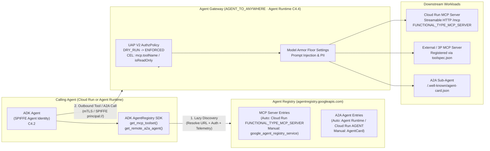

# Agent Registry, MCP Server & A2A Sub-Agent Governance Reference (Level 300/400)

> **When to Load This Reference (Progressive Disclosure)**
> Load this guide **only** when `prod_ready.py scan` detects one of the following in the user's project:
> 1. **Cloud Run MCP Server workload** (`FastMCP`, `mcp.server`, or `FUNCTIONAL_TYPE_MCP_SERVER`), OR
> 2. **Hardcoded remote MCP / A2A endpoints** (`MCP_SERVER_URL`, `StreamableHTTPConnectionParams(url=...)`, `SseConnectionParams(url=...)`, `RemoteA2aAgent(agent_card=...)`, `A2A_AGENT_URL`), OR
> 3. **User explicitly asks** to integrate **MCP servers** or **A2A sub-agents** with **Agent Registry** and **Agent Gateway**.
>
> For standalone single-agent workloads without MCP/A2A integration, skip this reference completely so there is zero noise.

---

## 1. End-to-End Governance Architecture (SPIFFE Identity → Agent Registry → Agent Gateway)



---

## 2. Three Workload Profiles Handled by `agent-production-readiness`

| Workload Profile | Auto-Detection Signal | `C4.2` Patching Behavior | `C4.2` Scoring & Advisory |
| :--- | :--- | :--- | :--- |
| **1. Standalone Single Agent** | `google.adk` / `Agent(` and **no** remote MCP/A2A URLs | Cloud Run: `FUNCTIONAL_TYPE_AGENT` + `IDENTITY_TYPE_AGENT_IDENTITY`<br>Agent Runtime: `identity_type = "AGENT_IDENTITY"` | `GREEN` (`100.0`) after patch — **zero MCP/A2A noise** |
| **2. Cloud Run MCP Server** | `FastMCP(` / `from mcp.server` / `FUNCTIONAL_TYPE_MCP_SERVER` (no ADK `Agent`) | Cloud Run: injects `provider = google-beta` + **`functional_type = "FUNCTIONAL_TYPE_MCP_SERVER"`** and **preserves dedicated `service_account`** (Agent Identity is NOT required for MCP servers) | `GREEN` (`100.0`) + MCP Server verification advisory (`gcloud beta agent-registry mcp-servers list`) |
| **3. MCP / A2A Client Agent** | Hardcoded `MCP_SERVER_URL`, `StreamableHTTPConnectionParams(url="http...")`, `SseConnectionParams(url="http...")`, `RemoteA2aAgent(agent_card="http...")` **without** `AgentRegistry` | Applies `C4.2` SPIFFE identity & `agentregistry.googleapis.com` in Terraform; **never blindly rewrites** user business logic in `agent.py` | Flags **`AMBER`** in `C4.2` + conditional advisory with exact `AgentRegistry` Lazy Discovery refactoring recipe below; becomes **`GREEN` (`100.0`)** once migrated to `AgentRegistry` |

---

## 3. Registering Workloads in Agent Registry

### 3.1 Cloud Run MCP Server (Auto-Registration — Recommended for GCP-Hosted MCP)

Cloud Run automatically discovers and registers an MCP server into Agent Registry when `functional_type = "FUNCTIONAL_TYPE_MCP_SERVER"` is set (`google-beta` provider).

- **Transport**: Expose **Streamable HTTP** (e.g., `/mcp`) via `FastMCP(stateless_http=True)` or MCP SDK Streamable HTTP transport.
- **Immutability Warning**: Once `functional_type` is set (`FUNCTIONAL_TYPE_AGENT` or `FUNCTIONAL_TYPE_MCP_SERVER`), it **cannot be changed or unset** in-place — you must recreate the service to change it.
- **Identity Rule**: Unlike agents (`IDENTITY_TYPE_AGENT_IDENTITY`), **MCP servers do NOT require Agent Identity**; keep a dedicated least-privilege Google Cloud Service Account.

```hcl
# deployment/terraform/service.tf (auto-patched by `prod_ready.py apply --items C4.2`)
resource "google_cloud_run_v2_service" "app" {
  provider            = google-beta
  name                = var.project_name
  location            = var.region
  project             = var.project_id
  deletion_protection = false
  ingress             = "INGRESS_TRAFFIC_ALL"
  functional_type     = "FUNCTIONAL_TYPE_MCP_SERVER" # [C4.2] Immutable — auto-registers in Agent Registry

  template {
    service_account = google_service_account.app_sa.email # Dedicated SA preserved for MCP servers
    # ...
  }
}
```

Verification command (read-only):

```bash
gcloud services enable agentregistry.googleapis.com apphub.googleapis.com --project=$PROJECT_ID
gcloud beta agent-registry mcp-servers list --location=$REGION --project=$PROJECT_ID
```

---

### 3.2 External / Non-GCP MCP Server (Manual Registration)

External or SaaS MCP servers are **not** auto-introspected; register them via `gcloud` or Terraform (`google_agent_registry_service`) using a `toolspec.json` manifest.

> **Important Constraints**
> - `toolspec.json` (`--mcp-server-spec-content`) has a **10 KB maximum size limit**.
> - Agent Registry **does not support `us` or `eu` multi-regions** — always use a specific regional location (e.g., `us-central1`, `asia-northeast3`).

**Option A — `gcloud` CLI:**

```bash
gcloud beta agent-registry services create billing-mcp-server \
  --location=$REGION \
  --project=$PROJECT_ID \
  --display-name="Enterprise Billing MCP Server" \
  --mcp-server-spec-type=tool-spec \
  --mcp-server-spec-content=toolspec.json \
  --interfaces="url=https://mcp.example.com/mcp,protocolBinding=jsonrpc"
```

**Option B — Terraform (`google-beta`):**

```hcl
resource "google_agent_registry_service" "external_mcp" {
  provider     = google-beta
  project      = var.project_id
  location     = var.region # Must be regional (no "us" or "eu" multi-region)
  service_id   = "billing-mcp-server"
  display_name = "Enterprise Billing MCP Server"

  interfaces {
    url              = "https://mcp.example.com/mcp"
    protocol_binding = "JSONRPC"
  }

  mcp_server_spec {
    type    = "TOOL_SPEC"
    content = file("${path.module}/toolspec.json") # Max 10 KB
  }
}
```

---

### 3.3 A2A Sub-Agent Registration (`AgentCard`)

- **Agent Runtime / Cloud Run (`FUNCTIONAL_TYPE_AGENT`)**: Auto-registered in Agent Registry when `agentregistry.googleapis.com` is enabled.
- **External A2A Agents**: Expose `/.well-known/agent-card.json` (A2A `AgentCard`) and register with `A2A_AGENT_CARD` or via `google-agents-cli publish` (A2A mode).
- Verify registered agents:

```bash
gcloud beta agent-registry agents list --location=$REGION --project=$PROJECT_ID
```

---

## 4. Refactoring Hardcoded MCP / A2A URLs → ADK `AgentRegistry` Lazy Discovery

When `prod_ready.py scan` flags `C4.2` as `AMBER` due to hardcoded URLs (`MCP_SERVER_URL`, `StreamableHTTPConnectionParams(url="https://...")`, `RemoteA2aAgent(agent_card="https://...")`), refactor `app/agent.py` to use ADK's official `AgentRegistry` integration (`google.adk.integrations.agent_registry`).

### Why Migrate Away from Hardcoded URLs?
1. **Zero Drift Endpoint Resolution**: `AgentRegistry` dynamically resolves the live registered URL from the regional catalog instead of stale hardcoded URLs.
2. **Automatic GCP Authentication**: `get_mcp_toolset()` automatically resolves `GcpAuthProviderScheme` credentials for IAM-authenticated Cloud Run / Agent Platform targets.
3. **Built-In Governance Telemetry**: Automatically tags OpenTelemetry spans with `gcp.mcp.server.destination.id` for per-tool auditing and cost attribution.

### Before (Anti-Pattern — Flagged as `AMBER` in `C4.2`)

```python
import os
from google.adk.agents import Agent
from google.adk.agents.remote_a2a_agent import RemoteA2aAgent
from google.adk.tools.mcp_tool import McpToolset, StreamableHTTPConnectionParams

# ❌ Hardcoded URLs bypass Agent Registry governance & drift across environments
mcp_tools = McpToolset(
    connection_params=StreamableHTTPConnectionParams(
        url=os.getenv("MCP_SERVER_URL", "https://currency-mcp-server-abc-uc.a.run.app/mcp"),
    )
)
billing_sub_agent = RemoteA2aAgent(
    name="billing_agent",
    agent_card="https://billing-agent-abc-uc.a.run.app/.well-known/agent-card.json",
)
```

### After (Recommended — Scores `GREEN` `100.0` in `C4.2`)

```python
import os
from google.adk.agents import Agent
from google.adk.integrations.agent_registry import AgentRegistry

PROJECT_ID = os.environ["GOOGLE_CLOUD_PROJECT"]
REGISTRY_LOCATION = os.getenv("AGENT_REGISTRY_LOCATION", "us-central1")

# ✅ Initialize regional Agent Registry client (never use "global", "us", or "eu")
registry = AgentRegistry(project_id=PROJECT_ID, location=REGISTRY_LOCATION)

# ✅ Lazy Discovery for MCP Server (returns AgentRegistrySingleMcpToolset with StreamableHTTP + GCP auth + telemetry)
mcp_tools = registry.get_mcp_toolset(
    mcp_server_name=os.environ["BILLING_MCP_REGISTRY_NAME"]
    # Format: "projects/{project}/locations/{location}/mcpServers/{mcp_server_id}"
)

# ✅ Lazy Discovery for A2A Sub-Agent (builds RemoteA2aAgent dynamically from registered AgentCard)
billing_sub_agent = registry.get_remote_a2a_agent(
    agent_name=os.environ["BILLING_A2A_REGISTRY_NAME"]
    # Format: "projects/{project}/locations/{location}/agents/{agent_id}"
)

# Optional: Discover agents dynamically by filter/tag
# available_agents = registry.list_agents(filter_str='display_name:"billing"')

root_agent = Agent(
    name="orchestrator_agent",
    model="gemini-2.5-flash",
    tools=[mcp_tools],
    sub_agents=[billing_sub_agent],
    instruction="Use registered MCP tools and A2A sub-agents to assist the user.",
)
```

> **Required IAM Role for the Calling Agent's SPIFFE Principal (`C4.2`)**
> Grant `roles/agentregistry.viewer` (read-only catalog lookup) to the agent's SPIFFE identity (`principal://agents.global.org-{ORG_ID}.system.id.goog/resources/aiplatform/projects/{PROJECT_NUMBER}/locations/{REGION}/reasoningEngines/{ENGINE_ID}` or Cloud Run SPIFFE principal).

---

## 5. Agent Gateway MCP Tool-Level RBAC (UAP V2 CEL · `C4.4` on Agent Runtime)

On **Agent Runtime** (`C4.4`), pairing **Agent Identity (SPIFFE ID)** + **Agent Registry** + **Agent Gateway (`AGENT_TO_ANYWHERE`)** enables **zero-code, tool-level authorization** over MCP traffic via IAM `roles/iap.egressor` with CEL conditions.

### 5.1 Read-Only vs. Privileged MCP Tool Policy (CEL Example)

```hcl
# Grant a specific Agent SPIFFE identity permission to invoke ONLY read-only or allowlisted MCP tools via Agent Gateway
resource "google_project_iam_member" "agent_mcp_readonly_egress" {
  project = var.project_id
  role    = "roles/iap.egressor"
  member  = "principal://agents.global.org-${var.org_id}.system.id.goog/resources/aiplatform/projects/${var.project_number}/locations/${var.region}/reasoningEngines/${google_vertex_ai_reasoning_engine.app.name}"

  condition {
    title       = "allow_readonly_or_named_mcp_tools"
    description = "Restrict agent egress to read-only MCP tools or explicit tool allowlist"
    expression  = "iap.googleapis.com/mcp.tool.isReadOnly == true || iap.googleapis.com/mcp.toolName in ['get_exchange_rate', 'lookup_invoice']"
  }
}
```

### 5.2 Safe Rollout & Operational Gotchas (Verified)

| Gotcha / Platform Limit | Production Impact | Mitigation |
| :--- | :--- | :--- |
| **`DRY_RUN` → `ENFORCED` Promotion** | Enabling `ENFORCED` immediately causes **HTTP 498** on unlisted platform APIs (`aiplatform`, `logging`, `monitoring`, `agentregistry`) or MCP/A2A hosts | Always deploy `C4.4` with `agent_gateway_enforcement_mode = "DRY_RUN"` first, audit Cloud Logging UAP V2 allow/deny decisions, then promote to `ENFORCED` |
| **1 Gateway per Project/Region (Agent Runtime)** | Only one `AGENT_TO_ANYWHERE` gateway binds per Agent Runtime deployment | To swap gateways in-place, first unbind with `agentGatewayConfig = {}` before binding the new gateway |
| **100% Latest Revision Traffic** | Gateway attachment fails if traffic is split across older revisions | Route 100% traffic to the latest revision before attaching or changing Agent Gateway |
| **Resource Quotas** | Max **5,000** Agent Registry resources per gateway; max **4** custom `AuthzPolicy` resources per gateway | Consolidate rules into clean policy groups instead of one `AuthzPolicy` per tool |
| **`network_attachment` is `ForceNew`** | Changing PSC Network Attachment on an existing Agent Gateway destroys & recreates the gateway | Plan subnet/VPC attachment before initial `terraform apply` |
| **No Private / Self-Signed CA on Egress** | Agent Gateway egress does not natively trust private/self-signed upstream certificates | Terminate upstream MCP/A2A endpoints with public-CA TLS certificates (e.g., Google-managed certs on Cloud Run / GCLB) |
| **Cloud Run Staged Adoption** | Managed `agent_gateway_config` binding is native to Agent Runtime | On Cloud Run, layer **Agent Identity + Agent Registry (`C4.2`)** and optional Self-Managed AGW progressively on top of GA **Direct VPC Egress + SWP/VPC-SC + IAP + Model Armor** |
