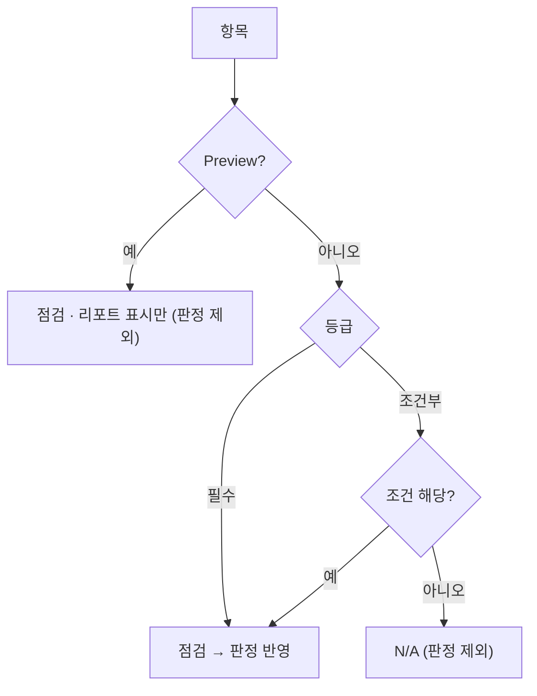

# Agent Production-Readiness 체크리스트 v3 루브릭 (`checklist-rubric.md`)

> **기준 데이터 (Single Source of Truth)**: [`scripts/prod_ready/catalog_v3.json`](../scripts/prod_ready/catalog_v3.json) · 정의서 [`docs/checklist-v3-spec.md`](../../../docs/checklist-v3-spec.md) · 웹 페이지 `/checklist` (`?track=cloud_run|agent_runtime|gke`)
> 이 문서의 항목 표는 카탈로그와 문구가 같아야 합니다. 카탈로그가 바뀌면 이 문서도 함께 갱신합니다.

---

## 1. 핵심 원칙 — 에이전트 특성에서 나온 항목만 점검

체크리스트에는 **"에이전트의 X 특성 때문에 Y를 해야 한다"** 로 설명할 수 있는 항목만 들어갑니다 (정의서 §0).

| 선정 기준 | 의미 |
| :--- | :--- |
| 에이전트 특성에서 나온다 | 대화 상태, LLM 비결정성, 자율적 도구 호출, 긴 응답, AI 생성 코드 등 에이전트 고유 특성이 근거 |
| 근거가 명확하다 | Google Cloud·Kubernetes 공식 문서, Google SRE 권장 사항 |
| 범용적이다 | 대부분의 에이전트에 적용. 일부에만 해당하면 **조건부**로 두고 조건을 명시 |
| 구체적이다 | GCP 서비스·설정 이름으로 명시 (예: `VertexAiSessionService`) |
| 판정할 수 있다 | 코드·설정에서 했는지 안 했는지 확인 가능 |
| 선택 사항이 아니다 | 값·아키텍처 선택·비용이 드는 선택형 제품·앱 설계 영역은 **권고 사항**(§6)으로만 안내 |

> [!IMPORTANT]
> **일반 플랫폼 BP는 이 체크리스트에서 점검하지 않습니다.** 헬스 프로브, PDB, Terraform IaC, 알림 정책, Non-Root, 사설 연결, PSS 같은 "모든 컨테이너 서비스에 해당하는" BP는 [google/skills · cloud](https://github.com/google/skills/tree/main/skills/cloud)의 **플랫폼 Skill을 함께 참조할 것을 적극 권장**합니다 (§5). 이 체크리스트를 모두 통과해도 플랫폼 Skill 점검을 대신하지 않습니다.

---

## 2. 판정 규칙 (Verdict)

ID 규칙: `<환경>-<범주><번호>` — 환경 `AR`(Agent Runtime) · `CR`(Cloud Run) · `GKE` (관리형 Agent Runtime → 제어권이 큰 GKE 순) / 범주 `F`(State & Memory) · `O`(Runtime Lifecycle) · `D`(CI/CD & Evaluation) · `OB`(Observability) · `S`(Security & Governance)

| 등급 | 판정 방식 |
| :--- | :--- |
| **필수** | 항상 점검합니다. 충족해야 Production Ready입니다. |
| **조건부** | 조건(멀티턴 대화 · 장기 기억 필요 · AI 생성 코드 실행 · MCP·외부 도구 호출 · 자주 일시정지·재개하는 상태 유지형 에이전트 · 사용자 대신 외부 도구 호출)이 **해당할 때만** 점검합니다. 해당하지 않으면 `N/A`로 표시하고 판정에서 제외합니다. 조건 판단은 [`intake-questionnaire.md`](intake-questionnaire.md) 참고. |
| **🅿️ Preview** | 등급(필수/조건부)과 무관하게 점검 결과를 리포트에 **표시만** 하고, 미충족이어도 Production Ready 판정을 **막지 않습니다**. 정식 출시(GA)되면 Preview 표시를 떼고 일반 항목으로 전환합니다. |

각 항목 결과는 `🟢 GREEN`(충족) · `🟡 AMBER`(부분 충족·보완 권장) · `🔴 RED`(미충족) · `⚪ N/A`(조건 미해당) 중 하나입니다.

| 게이트 판정 | 조건 (Preview·N/A 항목 제외) |
| :--- | :--- |
| 🟢 **Production Ready** | 판정 대상 항목이 모두 `GREEN` |
| 🟡 **Ready with Follow-ups** | `RED` 없음, `AMBER` 1개 이상 |
| 🔴 **Not Production Ready** | `RED` 1개 이상 |

---

## 3. 환경별 항목

### 3-1. 🛡️ Agent Runtime (`agent_runtime`)

| ID | 범주 | 항목 | 등급 | Preview | Check (에이전트 특성 → 확인 사항) | Best Practice | 참고 |
| :--- | :--- | :--- | :--- | :---: | :--- | :--- | :--- |
| `AR-F1` | State & Memory | 관리형 영속 세션 저장 (VertexAiSessionService) | 조건부 (멀티턴 대화) | — | Agent Runtime에는 `VertexAiSessionService`가 기본으로 연결되지만, 코드에서 `InMemorySessionService`로 덮어쓰면 재시작·스케일아웃 때 대화가 끊깁니다. 기본 관리형 세션을 그대로 쓰는지 확인합니다. | Agent Runtime에 기본으로 연결되는 `VertexAiSessionService`를 그대로 사용하고, 코드에서 다른 세션 서비스로 바꾸지 않습니다. | [Agent Platform Sessions](https://cloud.google.com/vertex-ai/generative-ai/docs/agent-engine/sessions/overview) · [ADK Sessions](https://google.github.io/adk-docs/sessions/session/) |
| `AR-F2` | State & Memory | 관리형 장기 기억 저장 (VertexAiMemoryBankService) | 조건부 (장기 기억 필요) | — | 개인화 에이전트는 세션이 끝난 뒤에도 사용자의 선호와 사실을 기억해야 합니다. 이런 에이전트에 Memory Bank가 연결되어 있는지 확인합니다. | `VertexAiMemoryBankService`(Memory Bank)로 세션 간 기억을 관리합니다. 같은 Agent Runtime 인스턴스의 Memory Bank를 사용합니다. | [Memory Bank](https://cloud.google.com/vertex-ai/generative-ai/docs/agent-engine/memory-bank/overview) · [ADK Memory](https://google.github.io/adk-docs/sessions/memory/) |
| `AR-D1` | CI/CD & Evaluation | CI/CD 파이프라인 (agents-cli) | 필수 | — | 에이전트 변경은 배포 전에 자동으로 테스트·평가되어야 하는데, 사람이 직접 배포하면 이 검증을 건너뛰게 됩니다. agents-cli로 생성한 CI/CD 파이프라인(`.cloudbuild/`)이 있는지 확인합니다. | `agents-cli scaffold enhance . --cicd-runner google_cloud_build`로 파이프라인(`.cloudbuild/`)을 생성해 PR 테스트 → staging 배포 → prod 승인 흐름을 코드로 둡니다. CI/CD 인프라 생성(`agents-cli infra cicd`)은 운영 환경 구성이므로 직접 수행합니다. | [agents-cli CI/CD](https://google.github.io/agents-cli/guide/deployment/) |
| `AR-D2` | CI/CD & Evaluation | 평가 데이터셋 · 평가 게이트 | 필수 | — | LLM 출력은 비결정적이라 프롬프트·모델·도구를 바꾸면 단위 테스트로 잡히지 않는 품질 저하가 생깁니다. 평가 데이터셋이 있고, 파이프라인 staging 단계에서 평가 점수가 기준에 못 미치면 prod 배포로 넘어가지 않는지 확인합니다. | `agents-cli eval`용 평가 데이터셋을 두고, 파이프라인 staging 단계에서 `agents-cli eval run` 점수를 기준값과 비교해 미달이면 실패하게 합니다(`eval run`은 점수와 무관하게 성공으로 끝나므로 비교 단계가 필요). | [ADK Evaluate](https://google.github.io/adk-docs/evaluate/) |
| `AR-OB1` | Observability | 프롬프트 미기록 | 필수 | — | 트레이스는 플랫폼이 기본으로 수집하지만, 프롬프트·응답에는 사용자 개인정보가 섞입니다. 트레이스에 메시지 본문이 기록되지 않는지 확인합니다. | GenAI 메시지 본문 수집은 끈 상태로 둡니다. | [OpenTelemetry GenAI](https://opentelemetry.io/docs/specs/semconv/gen-ai/) |
| `AR-S1` | Security & Governance | 에이전트 전용 신원 · 최소 권한 | 필수 | — | 에이전트는 스스로 판단해 도구·API를 호출하므로, 권한이 넓으면 프롬프트 인젝션 한 번으로도 피해가 커집니다. 기본 서비스 에이전트 권한에 의존하지 않고 에이전트 전용 신원으로 실행되고 필요한 권한만 갖는지 확인합니다. | Agent Identity(Preview)로 에이전트 고유 신원을 부여하고, 사용할 수 없으면 전용 서비스 계정을 지정합니다. 어느 쪽이든 필요한 최소 역할만 부여합니다. | [Agent Identity](https://docs.cloud.google.com/gemini-enterprise-agent-platform/govern/agent-identity-overview) · [IAM 보안 가이드](https://cloud.google.com/iam/docs/using-iam-securely) |
| `AR-S2` | Security & Governance | Agent Registry 등록 | 필수 | 🅿️ Preview | 팀마다 에이전트·MCP 서버를 만들면 조직은 어떤 에이전트가 무엇을 호출하는지 파악하기 어려워집니다. 에이전트가 Agent Registry에 등록되어 있는지 확인합니다. | Agent Registry에 에이전트를 등록해 조직 단위로 가시성과 거버넌스를 확보합니다. | [Agent Registry overview](https://docs.cloud.google.com/agent-registry/overview) |
| `AR-S3` | Security & Governance | Agent Gateway (외부 호출 통제) | 조건부 (MCP·외부 도구 호출) | 🅿️ Preview | 에이전트가 무엇을 호출할지는 LLM이 실행 시점에 정하므로, 코드 리뷰나 단순 방화벽·ALB만으로는 외부 호출을 통제할 수 없습니다. Agent Gateway(`AGENT_TO_ANYWHERE`)가 Agent Identity · Agent Registry · IAP V2 정책(`roles/iap.egressor` CEL) · Model Armor 검사 · 컨테이너 TLS CA 신뢰까지 한 세트로 연결되어 있는지 확인합니다. | 단순 게이트웨이 생성으로 끝나지 않습니다. ① Agent Identity(`AR-S1`)·Agent Registry(`AR-S2`)를 먼저 연결하고, ② `AGENT_TO_ANYWHERE` 게이트웨이에 `AuthzExtension`/`AuthzPolicy`(IAP V2, 반드시 `DRY_RUN` 시작 → 로그 검증 후 `ENFORCED` 전환해 HTTP 498 방지)와 MCP 도구별 `roles/iap.egressor` CEL 정책·Model Armor(`piAndJailbreak`·`sdp`) 검사를 부착하며, ③ `service.tf`의 `agent_gateway_config` 바인딩과 `Dockerfile`의 `AGENT_GATEWAY_ROOT_CERTIFICATES` CA 신뢰까지 함께 구성합니다. (외부 클라이언트 인바운드 보호 시 `CLIENT_TO_AGENT` + `roles/iap.httpsResourceAccessor` 별도 구성) | [Agent Gateway](https://docs.cloud.google.com/gemini-enterprise-agent-platform/govern/gateways/agent-gateway-overview) · [Model Armor](https://cloud.google.com/security-command-center/docs/model-armor-overview) |
| `AR-S4` | Security & Governance | AI 생성 코드 격리 (Code Execution) | 조건부 (AI 생성 코드 실행) | — | AI가 만든 코드는 신뢰할 수 없어, Agent Runtime 컨테이너에서 그대로 실행하면 에이전트 신원·자격증명이 탈취될 수 있습니다. 이런 코드가 관리형 Code Execution 샌드박스에서 격리되어 실행되는지 확인합니다. | 에이전트의 코드 실행을 Agent Platform Code Execution(관리형 샌드박스)에 맡깁니다. 샌드박스는 1초 이내에 생성되고 실행 상태를 TTL 동안 유지합니다. | [Agent Platform Code Execution](https://docs.cloud.google.com/gemini-enterprise-agent-platform/scale/sandbox/code-execution-overview) |
| `AR-S5` | Security & Governance | 사용자 위임 인증 (Agent Identity auth manager) | 조건부 (사용자 대신 외부 도구 호출) | 🅿️ Preview | 에이전트는 사용자를 대신해 Jira·GitHub 같은 외부 시스템을 호출하는데, 정적 API 키나 개인 토큰을 쓰면 모든 사용자가 같은 권한으로 접근하고 키가 유출되면 피해가 큽니다. 사용자 대신 호출하는 외부 도구가 auth manager로 위임받은 사용자 OAuth 토큰을 쓰는지 확인합니다. | auth manager에 auth provider(3-legged OAuth)를 구성하고, ADK가 도구·MCP 호출 시 사용자 위임 토큰을 받아 인증 헤더를 붙이게 합니다. 정적 API 키·PAT는 코드와 환경변수에 두지 않습니다. | [Agent Identity auth manager](https://docs.cloud.google.com/iam/docs/auth-manager-overview) · [3-legged OAuth with auth manager](https://docs.cloud.google.com/iam/docs/auth-with-3lo-v2) |

### 3-2. ⚡ Cloud Run (`cloud_run`)

| ID | 범주 | 항목 | 등급 | Preview | Check (에이전트 특성 → 확인 사항) | Best Practice | 참고 |
| :--- | :--- | :--- | :--- | :---: | :--- | :--- | :--- |
| `CR-F1` | State & Memory | 관리형 영속 세션 저장 (VertexAiSessionService) | 조건부 (멀티턴 대화) | — | 에이전트는 대화 맥락을 상태로 갖기 때문에, 세션이 인스턴스 메모리(`InMemorySessionService`)에만 있으면 인스턴스 재시작·스케일아웃 때 대화가 끊깁니다. 세션이 `VertexAiSessionService`에 저장되는지 확인합니다. | `VertexAiSessionService`로 세션을 저장해 인스턴스 재시작·스케일아웃 후에도 대화를 이어갑니다. Agent Platform 인스턴스 ID로 세션 저장소에 연결합니다. | [ADK Sessions](https://google.github.io/adk-docs/sessions/session/) · [Agent Platform Sessions](https://cloud.google.com/vertex-ai/generative-ai/docs/agent-engine/sessions/overview) |
| `CR-F2` | State & Memory | 관리형 장기 기억 저장 (VertexAiMemoryBankService) | 조건부 (장기 기억 필요) | — | 개인화 에이전트는 세션이 끝난 뒤에도 사용자의 선호와 사실을 기억해야 합니다. 이런 에이전트에 Memory Bank가 연결되어 있는지 확인합니다. | `VertexAiMemoryBankService`(Memory Bank)로 세션 간 기억을 관리합니다. Agent Platform 인스턴스 ID로 Memory Bank에 연결합니다. | [Memory Bank](https://cloud.google.com/vertex-ai/generative-ai/docs/agent-engine/memory-bank/overview) · [ADK Memory](https://google.github.io/adk-docs/sessions/memory/) |
| `CR-D1` | CI/CD & Evaluation | CI/CD 파이프라인 (agents-cli) | 필수 | — | 에이전트 변경은 배포 전에 자동으로 테스트·평가되어야 하는데, 사람이 직접 배포하면 이 검증을 건너뛰게 됩니다. agents-cli로 생성한 CI/CD 파이프라인(`.cloudbuild/`)이 있는지 확인합니다. | `agents-cli scaffold enhance . --cicd-runner google_cloud_build`로 파이프라인(`.cloudbuild/`)을 생성해 PR 테스트 → staging 배포 → prod 승인 흐름을 코드로 둡니다. CI/CD 인프라 생성(`agents-cli infra cicd`)은 운영 환경 구성이므로 직접 수행합니다. | [agents-cli CI/CD](https://google.github.io/agents-cli/guide/deployment/) |
| `CR-D2` | CI/CD & Evaluation | 평가 데이터셋 · 평가 게이트 | 필수 | — | LLM 출력은 비결정적이라 프롬프트·모델·도구를 바꾸면 단위 테스트로 잡히지 않는 품질 저하가 생깁니다. 평가 데이터셋이 있고, 파이프라인 staging 단계에서 평가 점수가 기준에 못 미치면 prod 배포로 넘어가지 않는지 확인합니다. | `agents-cli eval`용 평가 데이터셋을 두고, 파이프라인 staging 단계에서 `agents-cli eval run` 점수를 기준값과 비교해 미달이면 실패하게 합니다(`eval run`은 점수와 무관하게 성공으로 끝나므로 비교 단계가 필요). | [ADK Evaluate](https://google.github.io/adk-docs/evaluate/) |
| `CR-OB1` | Observability | Cloud Trace · 프롬프트 미기록 | 필수 | — | 에이전트는 한 요청 안에서 추론과 도구 호출을 여러 번 반복하므로, 단계별 트레이스가 있어야 실패·지연 원인을 찾을 수 있습니다. 에이전트·도구 호출이 Cloud Trace에 수집되고, 개인정보가 섞인 프롬프트·응답 본문은 기록되지 않는지 확인합니다. | ADK 텔레메트리를 Cloud Trace로 내보내고(`otel_to_cloud`), GenAI 메시지 본문 수집은 끈 상태로 둡니다. | [ADK Cloud Trace](https://google.github.io/adk-docs/observability/cloud-trace/) · [OpenTelemetry GenAI](https://opentelemetry.io/docs/specs/semconv/gen-ai/) |
| `CR-S1` | Security & Governance | 인증된 호출만 허용 | 필수 | — | 에이전트는 호출될 때마다 토큰 비용이 들고, 공개된 엔드포인트는 그대로 프롬프트 인젝션의 공격 대상이 됩니다. 서비스에 `allUsers` 호출 권한이 없어 인증된 호출만 받는지 확인합니다. | Cloud Run IAM 인증을 요구하고, 프런트엔드나 다른 서비스는 전용 서비스 계정으로 호출합니다. | [Cloud Run 인증](https://cloud.google.com/run/docs/authenticating/overview) |
| `CR-S2` | Security & Governance | 에이전트 전용 신원 · 최소 권한 | 필수 | — | 에이전트는 스스로 판단해 도구·API를 호출하므로, 권한이 넓으면 프롬프트 인젝션 한 번으로도 피해가 커집니다. 기본 Compute 서비스 계정이 아닌 에이전트 전용 신원으로 실행되고 필요한 권한만 갖는지 확인합니다. | Agent Identity(Preview)로 에이전트 고유 신원을 부여하고, 사용할 수 없으면 전용 서비스 계정을 씁니다. 어느 쪽이든 필요한 최소 역할만 부여합니다. | [Agent Identity](https://docs.cloud.google.com/gemini-enterprise-agent-platform/govern/agent-identity-overview) · [Cloud Run service identity](https://cloud.google.com/run/docs/securing/service-identity) · [IAM 보안 가이드](https://cloud.google.com/iam/docs/using-iam-securely) |
| `CR-S3` | Security & Governance | Agent Registry 등록 | 필수 | 🅿️ Preview | 팀마다 에이전트·MCP 서버를 만들면 조직은 어떤 에이전트가 무엇을 호출하는지 파악하기 어려워집니다. 에이전트(또는 MCP 서버)가 Agent Registry에 등록되어 있는지 확인합니다. | 서비스를 에이전트(또는 MCP 서버) 유형으로 배포해 Agent Registry에 자동 등록합니다. | [Cloud Run Agent Platform 기능](https://docs.cloud.google.com/run/docs/ai/agent-platform-features) |
| `CR-S4` | Security & Governance | Agent Gateway (외부 호출 통제) | 조건부 (MCP·외부 도구 호출) | 🅿️ Preview | 에이전트가 무엇을 호출할지는 LLM이 실행 시점에 정하므로, 코드 리뷰나 단순 방화벽·ALB만으로는 외부 호출을 통제할 수 없습니다. Agent Gateway for Cloud Run이 Agent Identity · Agent Registry · PSC/VPC DNS 라우팅 · IAP V2 정책(`DRY_RUN`→`ENFORCED`) · Model Armor 검사와 함께 구성되어 외부 호출을 통제하는지 확인합니다. | 단순 리소스 생성으로 끝나지 않습니다. ① Agent Identity(`CR-S2`)와 Agent Registry(`CR-S3`)에 Cloud Run 에이전트·MCP 대상을 등록하고, ② PSC Network Attachment(`private_ip_google_access=true`) + Cloud DNS(`*.run.app` 등)로 Egress 경로를 연결하며, ③ `AuthzExtension`/`AuthzPolicy`(IAP V2 `DRY_RUN`→`ENFORCED`, `roles/iap.egressor` CEL)와 Model Armor 필터(`piAndJailbreak`·`sdp`)를 적용한 뒤 `curl`이 아닌 런타임 SDK(Python)로 정책 동작을 검증합니다. | [Agent Gateway for Cloud Run](https://docs.cloud.google.com/gemini-enterprise-agent-platform/govern/gateways/cloud-run-overview) · [Model Armor](https://cloud.google.com/security-command-center/docs/model-armor-overview) |
| `CR-S5` | Security & Governance | AI 생성 코드 격리 (Cloud Run sandboxes) | 조건부 (AI 생성 코드 실행) | 🅿️ Preview | AI가 만든 코드는 신뢰할 수 없어, 에이전트 컨테이너에서 그대로 실행하면 서비스 계정 토큰이나 비밀값이 탈취될 수 있습니다. 이런 코드가 Cloud Run sandbox에서 격리되어 실행되는지 확인합니다. | 서비스에 `--sandbox-launcher`(2세대 실행 환경)를 켜고, 에이전트의 코드 실행 도구가 Cloud Run sandbox에서 코드를 실행하게 합니다. 샌드박스는 비밀값·환경변수·메타데이터 서버에 접근할 수 없고 외부 네트워크도 기본 차단됩니다. | [Code execution in Cloud Run](https://docs.cloud.google.com/run/docs/code-execution) |
| `CR-S6` | Security & Governance | 사용자 위임 인증 (Agent Identity auth manager) | 조건부 (사용자 대신 외부 도구 호출) | 🅿️ Preview | 에이전트는 사용자를 대신해 Jira·GitHub 같은 외부 시스템을 호출하는데, 정적 API 키나 개인 토큰을 쓰면 모든 사용자가 같은 권한으로 접근하고 키가 유출되면 피해가 큽니다. 사용자 대신 호출하는 외부 도구가 auth manager로 위임받은 사용자 OAuth 토큰을 쓰는지 확인합니다. | auth manager에 auth provider(3-legged OAuth)를 구성하고, ADK가 도구·MCP 호출 시 사용자 위임 토큰을 받아 인증 헤더를 붙이게 합니다. 정적 API 키·PAT는 코드와 환경변수에 두지 않습니다. | [Agent Identity auth manager](https://docs.cloud.google.com/iam/docs/auth-manager-overview) · [3-legged OAuth with auth manager](https://docs.cloud.google.com/iam/docs/auth-with-3lo-v2) |

### 3-3. ☸️ GKE (`gke`)

| ID | 범주 | 항목 | 등급 | Preview | Check (에이전트 특성 → 확인 사항) | Best Practice | 참고 |
| :--- | :--- | :--- | :--- | :---: | :--- | :--- | :--- |
| `GKE-F1` | State & Memory | 관리형 영속 세션 저장 (VertexAiSessionService) | 조건부 (멀티턴 대화) | — | 에이전트는 대화 맥락을 상태로 갖기 때문에, 세션이 Pod 메모리(`InMemorySessionService`)에만 있으면 Pod 재시작·스케일아웃 때 대화가 끊깁니다. 세션이 `VertexAiSessionService`에 저장되는지 확인합니다. | `VertexAiSessionService`로 세션을 저장해 Pod 재시작·스케일아웃 후에도 대화를 이어갑니다. Agent Platform 인스턴스 ID로 세션 저장소에 연결합니다. | [ADK Sessions](https://google.github.io/adk-docs/sessions/session/) · [Agent Platform Sessions](https://cloud.google.com/vertex-ai/generative-ai/docs/agent-engine/sessions/overview) |
| `GKE-F2` | State & Memory | 관리형 장기 기억 저장 (VertexAiMemoryBankService) | 조건부 (장기 기억 필요) | — | 개인화 에이전트는 세션이 끝난 뒤에도 사용자의 선호와 사실을 기억해야 합니다. 이런 에이전트에 Memory Bank가 연결되어 있는지 확인합니다. | `VertexAiMemoryBankService`(Memory Bank)로 세션 간 기억을 관리합니다. Agent Platform 인스턴스 ID로 Memory Bank에 연결합니다. | [Memory Bank](https://cloud.google.com/vertex-ai/generative-ai/docs/agent-engine/memory-bank/overview) · [ADK Memory](https://google.github.io/adk-docs/sessions/memory/) |
| `GKE-O1` | Runtime Lifecycle | 무중단 종료 (긴 응답 보호) | 필수 | — | 에이전트 한 턴은 LLM 스트리밍과 도구 호출로 수십 초 이상 걸려, 기본 종료 유예 시간(30초)으로는 배포·노드 업그레이드 때 응답이 잘릴 수 있습니다. `terminationGracePeriodSeconds`가 최대 응답 시간보다 길고, 종료 중에는 새 요청을 받지 않는지 확인합니다. | `terminationGracePeriodSeconds`를 최대 응답 시간 이상으로 두고, `preStop`과 readiness 프로브로 진행 중인 응답을 마친 뒤 종료합니다. | [Pod termination](https://kubernetes.io/docs/concepts/workloads/pods/pod-lifecycle/#pod-termination) · [Kubernetes Probes](https://kubernetes.io/docs/tasks/configure-pod-container/configure-liveness-readiness-startup-probes/) |
| `GKE-O2` | Runtime Lifecycle | 에이전트 일시정지 · 복원 (Agent Substrate · Agent Sandbox) | 조건부 (자주 일시정지·재개하는 상태 유지형 에이전트) | — | 세션별 실행 환경을 갖는 상태 유지형 에이전트는 대부분의 시간을 입력이나 트리거를 기다리며 보내는데, 그동안 Pod가 CPU·메모리를 계속 점유합니다. 유휴 에이전트가 일시정지되어 컴퓨팅을 반납하고, 요청이 오면 메모리·작업 파일 상태가 복원되는지 확인합니다. | Agent Substrate on GKE에서 실행해 유휴 actor를 Cloud Storage 스냅샷으로 일시정지하고 워커의 CPU·메모리를 반납하며, 요청 시 1초 이내에 복원합니다(GKE Standard 1.37 이상, x86 노드). Agent Sandbox on GKE를 써야 하는 경우에는 Sandbox를 `Suspended`로 전환하기 전에 Pod snapshot(gVisor 전용, 복원 약 3~5초)으로 상태를 저장합니다. | [Plan an architecture for AI agent workloads on GKE](https://docs.cloud.google.com/kubernetes-engine/docs/concepts/machine-learning/agent-workloads) · [Agent Substrate on GKE](https://docs.cloud.google.com/kubernetes-engine/ai-ml/about-agent-substrate) · [Agent Sandbox on GKE](https://docs.cloud.google.com/kubernetes-engine/docs/concepts/machine-learning/agent-sandbox) |
| `GKE-D1` | CI/CD & Evaluation | CI/CD 파이프라인 (agents-cli) | 필수 | — | 에이전트 변경은 배포 전에 자동으로 테스트·평가되어야 하는데, 사람이 직접 배포하면 이 검증을 건너뛰게 됩니다. agents-cli로 생성한 CI/CD 파이프라인(`.cloudbuild/`)이 있는지 확인합니다. | `agents-cli scaffold enhance . --cicd-runner google_cloud_build`로 파이프라인(`.cloudbuild/`)을 생성해 PR 테스트 → staging 배포 → prod 승인 흐름을 코드로 둡니다. CI/CD 인프라 생성(`agents-cli infra cicd`)은 운영 환경 구성이므로 직접 수행합니다. | [agents-cli CI/CD](https://google.github.io/agents-cli/guide/deployment/) |
| `GKE-D2` | CI/CD & Evaluation | 평가 데이터셋 · 평가 게이트 | 필수 | — | LLM 출력은 비결정적이라 프롬프트·모델·도구를 바꾸면 단위 테스트로 잡히지 않는 품질 저하가 생깁니다. 평가 데이터셋이 있고, 파이프라인 staging 단계에서 평가 점수가 기준에 못 미치면 prod 배포로 넘어가지 않는지 확인합니다. | `agents-cli eval`용 평가 데이터셋을 두고, 파이프라인 staging 단계에서 `agents-cli eval run` 점수를 기준값과 비교해 미달이면 실패하게 합니다(`eval run`은 점수와 무관하게 성공으로 끝나므로 비교 단계가 필요). | [ADK Evaluate](https://google.github.io/adk-docs/evaluate/) |
| `GKE-OB1` | Observability | Cloud Trace · 프롬프트 미기록 | 필수 | — | 에이전트는 한 요청 안에서 추론과 도구 호출을 여러 번 반복하므로, 단계별 트레이스가 있어야 실패·지연 원인을 찾을 수 있습니다. 에이전트·도구 호출이 Cloud Trace에 수집되고, 개인정보가 섞인 프롬프트·응답 본문은 기록되지 않는지 확인합니다. | ADK 텔레메트리를 Cloud Trace로 내보내고(`otel_to_cloud`), GenAI 메시지 본문 수집은 끈 상태로 둡니다. | [ADK Cloud Trace](https://google.github.io/adk-docs/observability/cloud-trace/) · [OpenTelemetry GenAI](https://opentelemetry.io/docs/specs/semconv/gen-ai/) |
| `GKE-S1` | Security & Governance | 에이전트 전용 신원 · 최소 권한 | 필수 | — | 에이전트는 스스로 판단해 도구·API를 호출하므로, 권한이 넓으면 프롬프트 인젝션 한 번으로도 피해가 커집니다. Pod가 노드 기본 서비스 계정이 아닌 에이전트 전용 신원으로 실행되고 필요한 권한만 갖는지 확인합니다. | Agent Identity(Preview)로 에이전트 고유 신원을 부여하고, 사용할 수 없으면 Workload Identity로 전용 서비스 계정을 연결합니다. 어느 쪽이든 필요한 최소 역할만 부여합니다. | [Agent Identity](https://docs.cloud.google.com/gemini-enterprise-agent-platform/govern/agent-identity-overview) · [Workload Identity](https://cloud.google.com/kubernetes-engine/docs/concepts/workload-identity) · [IAM 보안 가이드](https://cloud.google.com/iam/docs/using-iam-securely) |
| `GKE-S2` | Security & Governance | AI 생성 코드 격리 (Agent Substrate · Agent Sandbox) | 조건부 (AI 생성 코드 실행) | — | AI가 만든 코드는 신뢰할 수 없어, 에이전트 Pod 안에서 그대로 실행하면 자격증명 탈취나 노드 침해로 이어질 수 있습니다. 이런 코드가 에이전트 Pod가 아닌 격리된 샌드박스(Agent Substrate 또는 Agent Sandbox)에서 실행되는지 확인합니다. | AI 생성 코드는 에이전트 Pod가 아닌 격리된 샌드박스에서 실행합니다. Agent Substrate on GKE를 기본으로 사용하고(GKE Standard 1.37 이상, x86 노드), 상시 실행 에이전트, 사이드카 등 전체 PodSpec, Arm 노드, Autopilot이 필요하면 Agent Sandbox on GKE를 사용합니다. | [Plan an architecture for AI agent workloads on GKE](https://docs.cloud.google.com/kubernetes-engine/docs/concepts/machine-learning/agent-workloads) · [Agent Substrate on GKE](https://docs.cloud.google.com/kubernetes-engine/ai-ml/about-agent-substrate) · [Agent Sandbox on GKE](https://docs.cloud.google.com/kubernetes-engine/docs/concepts/machine-learning/agent-sandbox) |
| `GKE-S3` | Security & Governance | Agent Registry 등록 | 필수 | 🅿️ Preview | 팀마다 에이전트·MCP 서버를 만들면 조직은 어떤 에이전트가 무엇을 호출하는지 파악하기 어려워집니다. 에이전트 워크로드가 Agent Registry에 등록되어 있는지 확인합니다. | Deployment에 에이전트 유형 레이블을 지정해 Agent Registry에 자동 등록합니다. | [Agent Registry overview](https://docs.cloud.google.com/agent-registry/overview) · [About Agent Identity for GKE](https://docs.cloud.google.com/kubernetes-engine/security/about-agent-identity) |
| `GKE-S4` | Security & Governance | Agent Gateway for GKE (외부 호출 통제) | 조건부 (MCP·외부 도구 호출) | 🅿️ Preview | 에이전트가 무엇을 호출할지는 LLM이 실행 시점에 정하므로, 일반 Ingress·Gateway만으로는 MCP·외부 도구 호출을 통제할 수 없습니다. Agent Gateway for GKE(Standard Pod 전용 · Rapid 1.37.2+ · Ambient · Dataplane V2 · Fleet · Proxy-only subnet)가 Ingress/Egress CRD 정책 및 Model Armor 바인딩과 함께 구성되어 있는지 확인합니다. | 일반 Gateway 생성으로 끝나지 않습니다. Standard Pod 환경(Agent Sandbox·Substrate 미지원)에서 ① Ingress는 `Gateway` + `HTTPRoute` + `GCPAgentGateway` + `GCPAuthzPolicy`(L7 MCP `tools/list`·`tools/call` RBAC) + `GCPExtensionBinding`(Model Armor, 반드시 `GCPAgentGateway` 타겟)을 구성하고, ② Egress는 네임스페이스 `networking.gke.io/dataplane-mode=ambient` 라벨 + `GCPBackend`(SWP) + `GCPEgressPolicy`(클러스터 CIDR 제외) + 컨트롤 플레인 IAP/Model Armor `ExtensionBinding`을 함께 구성합니다. | [Agent Gateway for GKE](https://docs.cloud.google.com/gemini-enterprise-agent-platform/govern/gateways/gke-overview) · [Model Armor](https://cloud.google.com/security-command-center/docs/model-armor-overview) |
| `GKE-S5` | Security & Governance | 사용자 위임 인증 (Agent Identity auth manager) | 조건부 (사용자 대신 외부 도구 호출) | 🅿️ Preview | 에이전트는 사용자를 대신해 Jira·GitHub 같은 외부 시스템을 호출하는데, 정적 API 키나 개인 토큰을 쓰면 모든 사용자가 같은 권한으로 접근하고 키가 유출되면 피해가 큽니다. 사용자 대신 호출하는 외부 도구가 auth manager로 위임받은 사용자 OAuth 토큰을 쓰는지 확인합니다. | auth manager에 auth provider(3-legged OAuth)를 구성하고, ADK가 도구·MCP 호출 시 사용자 위임 토큰을 받아 인증 헤더를 붙이게 합니다. 정적 API 키·PAT는 코드와 환경변수에 두지 않습니다. | [Agent Identity auth manager](https://docs.cloud.google.com/iam/docs/auth-manager-overview) · [3-legged OAuth with auth manager](https://docs.cloud.google.com/iam/docs/auth-with-3lo-v2) |

## 4. 기존 `C*` ID → v3 ID (별칭)

이전 버전의 `C*` ID(예: `--items C2.1,C4.1`)는 **별칭으로 계속 받습니다**. 엔진이 대상 환경의 v3 ID로 바꿔 해석하며, 위임된 일반 BP에 해당하는 `C*` ID는 점검 대상이 아닙니다. `C6.2`(Gemini 호출 재시도 · 엔드포인트)는 ADK 최적화(에이전트 코드) 영역이라 v3에서 제외되었고, 지정하면 CLI가 범위 밖임을 안내합니다.

| 기존 ID | v3 ID | 비고 |
| :--- | :--- | :--- |
| `C2.1` 세션 | `AR-F1` · `CR-F1` · `GKE-F1` | 장기 기억 `AR-F2` · `CR-F2` · `GKE-F2`는 이전 ID 없음 |
| `C6.2` Gemini 429 | — (범위 밖) | ADK 최적화(에이전트 코드) 영역 — 점검·패치하지 않음 |
| `C1.2` 프로브·HA | `GKE-O1` (무중단 종료만) | 프로브·PDB·CPU 부스트는 플랫폼 Skill로 위임 |
| `C7.1` 평가 게이트 | `AR-D1`+`AR-D2` · `CR-D1`+`CR-D2` · `GKE-D1`+`GKE-D2` | D1 CI/CD 파이프라인(agents-cli, 안내만) + D2 평가 데이터셋 · 평가 게이트 |
| `C5.1` 트레이스 (`C5.2` 포함) | `AR-OB1` · `CR-OB1` · `GKE-OB1` |  |
| `C4.1` + `C4.2`(신원) | `AR-S1` · `CR-S2` · `GKE-S1` |  |
| `C4.2`(Registry) | `AR-S2` · `CR-S3` · `GKE-S3` | Preview |
| `C4.2`(사용자 위임 인증) | `AR-S5` · `CR-S6` · `GKE-S5` | Preview · 조건부 (사용자 대신 외부 도구 호출) · 안내만 |
| `C4.4` Gateway / 코드 격리 | `AR-S3` · `CR-S4` · `GKE-S4` / `AR-S4` · `CR-S5` · `GKE-S2` | Gateway · Cloud Run sandboxes는 Preview |
| (이전 ID 없음) | `CR-S1` 인증된 호출만 허용 · `GKE-O2` 에이전트 일시정지 · 복원 (Agent Substrate · Agent Sandbox) |  |
| `C1.1` · `C5.3` · `C3.1` · `C4.3` | — | 플랫폼 Skill로 위임 (§5) |

## 5. 위임된 일반 플랫폼 BP → 플랫폼 Skill 함께 참조 (적극 권장)

아래 BP는 에이전트가 아니어도 모든 컨테이너 서비스에 해당하므로 체크리스트에서 점검하지 않습니다. 대신 [google/skills · cloud](https://github.com/google/skills/tree/main/skills/cloud)의 플랫폼 Skill로 **반드시 함께 점검하도록 사용자에게 안내**합니다.

| 일반 BP | 참조 Skill |
| :--- | :--- |
| 헬스 프로브 (startup·liveness) | [`cloud-run-basics`](https://github.com/google/skills/tree/main/skills/cloud/cloud-run-basics) · [`gke-reliability`](https://github.com/google/skills/tree/main/skills/cloud/gke-reliability) |
| 멀티존 · PodDisruptionBudget | [`gke-reliability`](https://github.com/google/skills/tree/main/skills/cloud/gke-reliability) · [`gke-productionize`](https://github.com/google/skills/tree/main/skills/cloud/gke-productionize) |
| Terraform IaC · 드리프트 방지 | [`google-cicd-terraform`](https://github.com/google/skills/tree/main/skills/cloud/google-cicd-terraform) |
| 지연·오류율 알림 정책 | [`cloud-run-alert-configuration`](https://github.com/google/skills/tree/main/skills/cloud/cloud-run-alert-configuration) · [`agent-platform-alert-configuration`](https://github.com/google/skills/tree/main/skills/cloud/agent-platform-alert-configuration) · [`gke-alert-configuration`](https://github.com/google/skills/tree/main/skills/cloud/gke-alert-configuration) |
| Secret Manager 버전 고정 | [`cloud-run-basics`](https://github.com/google/skills/tree/main/skills/cloud/cloud-run-basics) |
| Non-Root 컨테이너 | [`cloud-run-basics`](https://github.com/google/skills/tree/main/skills/cloud/cloud-run-basics) · [`gke-workload-security`](https://github.com/google/skills/tree/main/skills/cloud/gke-workload-security) |
| Direct VPC Egress · PSC Interface (사설 연결) | [`cloud-run-basics`](https://github.com/google/skills/tree/main/skills/cloud/cloud-run-basics) · [`google-cloud-waf-security`](https://github.com/google/skills/tree/main/skills/cloud/google-cloud-waf-security) |
| Private Nodes · NetworkPolicy | [`gke-networking`](https://github.com/google/skills/tree/main/skills/cloud/gke-networking) · [`gke-workload-security`](https://github.com/google/skills/tree/main/skills/cloud/gke-workload-security) |
| Pod Security Standards | [`gke-workload-security`](https://github.com/google/skills/tree/main/skills/cloud/gke-workload-security) |
| 서비스 계정 키(JSON) 미사용 · Workload Identity Federation | [`gke-workload-identity`](https://github.com/google/skills/tree/main/skills/cloud/gke-workload-identity) · [`iam-helper-for-policy-management`](https://github.com/google/skills/tree/main/skills/cloud/iam-helper-for-policy-management) |

환경별 함께 참조 권장 Skill:

- **Agent Runtime**: [`agent-platform-deploy`](https://github.com/google/skills/tree/main/skills/cloud/agent-platform-deploy) · [`agent-platform-agent-registry`](https://github.com/google/skills/tree/main/skills/cloud/agent-platform-agent-registry) · [`agent-platform-access-audit`](https://github.com/google/skills/tree/main/skills/cloud/agent-platform-access-audit) · [`agent-platform-alert-configuration`](https://github.com/google/skills/tree/main/skills/cloud/agent-platform-alert-configuration)
- **Cloud Run**: [`cloud-run-basics`](https://github.com/google/skills/tree/main/skills/cloud/cloud-run-basics) · [`cloud-run-alert-configuration`](https://github.com/google/skills/tree/main/skills/cloud/cloud-run-alert-configuration) · [`google-cicd-terraform`](https://github.com/google/skills/tree/main/skills/cloud/google-cicd-terraform) · [`google-cloud-waf-security`](https://github.com/google/skills/tree/main/skills/cloud/google-cloud-waf-security)
- **GKE**: [`gke-productionize`](https://github.com/google/skills/tree/main/skills/cloud/gke-productionize) · [`gke-reliability`](https://github.com/google/skills/tree/main/skills/cloud/gke-reliability) · [`gke-workload-security`](https://github.com/google/skills/tree/main/skills/cloud/gke-workload-security) · [`gke-workload-identity`](https://github.com/google/skills/tree/main/skills/cloud/gke-workload-identity) · [`gke-networking`](https://github.com/google/skills/tree/main/skills/cloud/gke-networking) · [`gke-alert-configuration`](https://github.com/google/skills/tree/main/skills/cloud/gke-alert-configuration)

## 6. 권고 사항 (체크리스트 아님 · 판정에 영향 없음)

값·아키텍처 선택·비용이 드는 선택형 제품은 점검하지 않고, 해당 상황일 때만 안내합니다.

| 대상 | 권고 사항 | 검토 시점 |
| :--- | :--- | :--- |
| Cloud Run | 시작 CPU 부스트 | 기동이 느린 런타임에서 콜드스타트를 줄여야 할 때 |
| Cloud Run | 요청 타임아웃 · 최소 인스턴스 | 에이전트 최대 응답 시간과 지연 민감도 (부하 테스트로 결정) |
| Cloud Run | 1세대 / 2세대 실행 환경 | 콜드스타트가 우선이면 1세대, 성능·호환성이 우선이면 2세대 |
| Agent Runtime | 최소/최대 인스턴스 · 동시성 | 트래픽 패턴과 지연 요구 |
| GKE | HPA · 리소스 요청/한도 | 트래픽 변동 폭과 부하 테스트 결과 |
| Agent Runtime · Cloud Run · GKE | Secure Web Proxy (이그레스 프록시) | Agent Gateway를 쓸 수 없는 환경에서 외부 호출 통제가 필요할 때 (비용 발생) |
| Agent Runtime · Cloud Run · GKE | Model Armor (프롬프트·응답 검사) | 외부 사용자 대상이거나 민감정보를 다룰 때 (비용 발생) |
| Cloud Run · GKE | Cloud Armor · IAP (외부 노출 보호) | 에이전트를 인터넷에 직접 노출할 때 (비용 발생) |
| Agent Runtime · Cloud Run · GKE | 모델 용량 확보 (Provisioned Throughput 등) | 레지던시로 리전을 고정해 429 위험이 크거나 SLA가 필요할 때 |

## 7. 참고

- 정의서(선정 기준·뺀 항목·위임 BP): [`docs/checklist-v3-spec.md`](../../../docs/checklist-v3-spec.md) (저장소 기준)
- Google Cloud 플랫폼 Skill: https://github.com/google/skills/tree/main/skills/cloud
- ADK 문서: https://google.github.io/adk-docs/
