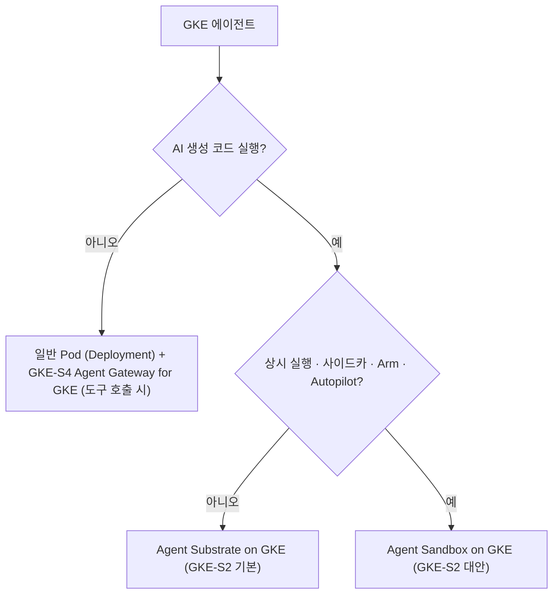

# GKE 에이전트 프로덕션 가이드 (`gke-hardening.md`, 체크리스트 v3)

> 파일 이름은 링크 호환을 위해 유지합니다. 항목 정의는 [`checklist-rubric.md`](checklist-rubric.md) §3-3 · [`catalog_v3.json`](../scripts/prod_ready/catalog_v3.json)이 기준입니다.
> 이 문서는 **에이전트 특성에서 나온 항목**(`GKE-*`)만 다룹니다. 멀티존·PDB·헬스 프로브·Private Nodes·NetworkPolicy·PSS 같은 일반 Kubernetes BP는 §4의 플랫폼 Skill을 함께 참조하세요.

---

## 1. 항목 요약

| ID | 항목 | 등급 | 충족 방법 (요약) |
| :--- | :--- | :--- | :--- |
| `GKE-F1` | 관리형 영속 세션 저장 (VertexAiSessionService) | 조건부 (멀티턴 대화) | `session_service_uri="agentengine://<AGENT_ENGINE_ID>"` — Pod 메모리에 세션을 두지 않음 |
| `GKE-F2` | 관리형 장기 기억 저장 (VertexAiMemoryBankService) | 조건부 (장기 기억 필요) | `memory_service_uri="agentengine://<AGENT_ENGINE_ID>"` (`VertexAiMemoryBankService`) |
| `GKE-O1` | 무중단 종료 (긴 응답 보호) | 필수 | `terminationGracePeriodSeconds` ≥ 최대 응답 시간 + `preStop` + readiness 프로브 |
| `GKE-O2` | 에이전트 일시정지 · 복원 (Agent Substrate · Agent Sandbox) | 조건부 (자주 일시정지·재개하는 상태 유지형 에이전트) | Agent Substrate on GKE에서 실행 — 유휴 시 스냅샷 일시정지 · 요청 시 복원 (GKE Standard 1.37 이상) |
| `GKE-D1` | CI/CD 파이프라인 (agents-cli) | 필수 | `agents-cli scaffold enhance . --cicd-runner google_cloud_build`로 `.cloudbuild/` 생성 (엔진은 생성하지 않음 · 안내만) |
| `GKE-D2` | 평가 데이터셋 · 평가 게이트 | 필수 | `tests/eval/` 평가 데이터셋 + staging 단계에서 `agents-cli eval run` 점수를 기준값과 비교 — 미달이면 prod 승격 차단 |
| `GKE-OB1` | Cloud Trace · 프롬프트 미기록 | 필수 | `otel_to_cloud=True` + GenAI 메시지 본문 수집 끔 |
| `GKE-S1` | 에이전트 전용 신원 · 최소 권한 | 필수 | Agent Identity(Preview) 우선, 불가 시 Workload Identity로 전용 서비스 계정 연결 |
| `GKE-S2` | AI 생성 코드 격리 (Agent Substrate · Agent Sandbox) | 조건부 (AI 생성 코드 실행) | AI 생성 코드를 Agent Substrate 샌드박스에서 실행 (대안: Agent Sandbox on GKE) |
| `GKE-S3` | Agent Registry 등록 | 필수 · 🅿️ Preview | Deployment에 에이전트 유형 레이블 지정 → 자동 등록 |
| `GKE-S4` | Agent Gateway for GKE (외부 호출 통제) | 조건부 (MCP·외부 도구 호출) · 🅿️ Preview | Agent Gateway for GKE로 외부 호출에 접근 정책 적용 |
| `GKE-S5` | 사용자 위임 인증 (Agent Identity auth manager) | 조건부 (사용자 대신 외부 도구 호출) · 🅿️ Preview | auth manager auth provider(3-legged OAuth)로 받은 사용자 위임 토큰을 도구·MCP 호출에 사용 — 정적 API 키·PAT 미사용 (`google-adk[agent-identity]`, 엔진은 점검·안내만) |

🅿️ Preview 항목은 점검·안내하지만 Production Ready 판정을 막지 않습니다.

> **기존 값 보존**: 엔진은 클러스터 모드(Autopilot/Standard), Pod `requests`/`limits`, HPA `min_replicas`/`max_replicas`를 바꾸지 않습니다.

---

## 2. 항목별 구현

### `GKE-F1` 관리형 영속 세션 저장 (VertexAiSessionService) · `GKE-F2` 관리형 장기 기억 저장 (VertexAiMemoryBankService)

Cloud Run과 같은 코드입니다 ([`cloud-run-hardening.md`](cloud-run-hardening.md) `CR-F1`·`CR-F2` 참고). Deployment 환경변수로 Agent Platform 인스턴스 ID와 위치를 전달합니다.

```hcl
env {
  name  = "AGENT_ENGINE_ID"
  value = var.agent_engine_id
}
env {
  name  = "GOOGLE_CLOUD_AGENT_ENGINE_LOCATION"
  value = var.region
}
```

- 참고: [ADK Sessions](https://google.github.io/adk-docs/sessions/session/) · [Agent Runtime Sessions](https://cloud.google.com/vertex-ai/generative-ai/docs/agent-engine/sessions/overview) · [Memory Bank](https://cloud.google.com/vertex-ai/generative-ai/docs/agent-engine/memory-bank/overview) · [ADK Memory](https://google.github.io/adk-docs/sessions/memory/)

### `GKE-O1` 무중단 종료 (긴 응답 보호)

에이전트 한 턴(LLM 스트리밍 + 도구 호출)은 수십 초 이상 걸립니다. 기본 유예 시간 30초로는 롤링 배포·노드 업그레이드 때 응답이 잘립니다.

```hcl
# kubernetes_deployment_v1.app — spec.template.spec
termination_grace_period_seconds = 120   # 최대 응답 시간 이상 (--params gke_termination_grace_seconds)

container {
  lifecycle {
    pre_stop {
      exec { command = ["/bin/sh", "-c", "sleep 10"] }   # 엔드포인트 제거가 전파될 때까지 대기
    }
  }
  readiness_probe {
    http_get {
      path = "/list-apps"
      port = 8080
    }
  }
}
```

종료 신호를 받으면 readiness가 실패해 새 요청이 들어오지 않고, 진행 중인 응답은 유예 시간 안에 마칩니다. 프로브 자체의 설계·멀티존·PDB는 일반 BP로 [`gke-reliability`](https://github.com/google/skills/tree/main/skills/cloud/gke-reliability)를 참고합니다.

- 참고: [Pod termination](https://kubernetes.io/docs/concepts/workloads/pods/pod-lifecycle/#pod-termination) · [Kubernetes Probes](https://kubernetes.io/docs/tasks/configure-pod-container/configure-liveness-readiness-startup-probes/)

### `GKE-O2` 에이전트 일시정지 · 복원 (Agent Substrate · Agent Sandbox) — 조건부

대화형 에이전트는 대부분의 시간을 사용자 입력이나 도구 응답을 기다리며 보내므로, Pod를 계속 띄워 두면 유휴 에이전트가 CPU·메모리를 점유합니다. Agent Substrate on GKE에서 실행하면 유휴 에이전트의 메모리·파일을 스냅샷으로 저장하고 새 요청이 오면 warm worker로 빠르게 복원합니다.

- **조건 판단**: "자주 일시정지·재개하는 상태 유지형 에이전트"(`idle`)는 코드로 판단할 수 없습니다. Agent Substrate(`ate.dev/v1alpha1` `WorkerPool`/`ActorTemplate`)를 이미 쓰고 있으면 해당으로 보고, 그렇지 않으면 `N/A`로 표시하고 사용자에게 묻습니다.
- **사용자 지정(opt-in)**: `scan … --conditions idle=true`로 점검하고, `apply … --items GKE-O2`(명시 선택) 또는 `apply … --items ALL --conditions idle=true`로 적용합니다. `ALL`만으로는 조건이 확인되지 않아 적용하지 않습니다.
- **엔진 산출물**: `GKE-S2`와 같은 `deployment/k8s/agent-substrate.yaml`을 재사용합니다. 프로토타입에서는 GKE Standard 클러스터 + N2 워커 풀로 scaffold하며, 기존 Autopilot 클러스터는 바꾸지 않으므로 `GKE-O2`가 🟡(Standard 필요)로 남습니다.
- 참고: [Agent Substrate on GKE](https://docs.cloud.google.com/kubernetes-engine/ai-ml/about-agent-substrate)

### `GKE-D1` · `GKE-D2` · `GKE-OB1`

Cloud Run의 `CR-D1` · `CR-D2` · `CR-OB1`과 같은 파이프라인·설정입니다 ([`cloud-run-hardening.md`](cloud-run-hardening.md) 참고). 평가 게이트는 `agents-cli scaffold enhance . --cicd-runner google_cloud_build`로 만든 파이프라인에만 넣으며(엔진은 파이프라인을 생성하지 않음), `agents-cli infra cicd`는 사용자가 직접 수행합니다. 환경변수(`OTEL_INSTRUMENTATION_GENAI_CAPTURE_MESSAGE_CONTENT=NO_CONTENT`, `ADK_CAPTURE_MESSAGE_CONTENT_IN_SPANS=false`)는 Deployment 컨테이너 `env`로 지정하고, 트레이스 내보내기는 Workload Identity 서비스 계정에 `roles/cloudtrace.agent`가 필요합니다.

### `GKE-S1` 에이전트 전용 신원 · 최소 권한

```hcl
# 우선: Agent Identity (Preview) — Pod 템플릿 어노테이션
metadata {
  annotations = { "iam.gke.io/spiffe-identity-type" = "agent-identity" }
}

# 대안: Workload Identity로 전용 서비스 계정 연결 (노드 기본 서비스 계정 사용 금지)
resource "kubernetes_service_account_v1" "agent" {
  metadata {
    name        = "agent-ksa"
    namespace   = var.namespace
    annotations = { "iam.gke.io/gcp-service-account" = google_service_account.agent.email }
  }
}
```

어느 쪽이든 필요한 최소 역할만 부여합니다. Workload Identity 설정 세부는 [`gke-workload-identity`](https://github.com/google/skills/tree/main/skills/cloud/gke-workload-identity) Skill을 참고합니다.

- 참고: [Agent Identity](https://docs.cloud.google.com/gemini-enterprise-agent-platform/govern/agent-identity-overview) · [Workload Identity](https://cloud.google.com/kubernetes-engine/docs/concepts/workload-identity) · [IAM 보안 가이드](https://cloud.google.com/iam/docs/using-iam-securely)

### `GKE-S2` AI 생성 코드 격리 (Agent Substrate · Agent Sandbox) — 조건부

AI가 만든 코드·셸을 실행할 때만 적용합니다. 이런 코드를 에이전트 Pod 안에서 그대로 실행하면 자격증명 탈취·노드 침해로 이어질 수 있으므로 커널·네트워크가 격리된 샌드박스에서 실행합니다.

| 구분 | Agent Substrate on GKE (기본) | Agent Sandbox on GKE (대안) |
| :--- | :--- | :--- |
| 선택 기준 | AI 생성 코드 실행 샌드박스의 기본 선택 | 상시 실행·전체 PodSpec(사이드카)·Arm 노드·**Autopilot**이 필요해 쓸 때 |
| API | `ate.dev/v1alpha1` `WorkerPool` + `kubectl ate` `ActorTemplate` | `extensions.agents.x-k8s.io/v1beta1` (`SandboxTemplate` · `SandboxWarmPool` · `SandboxClaim`) |
| 클러스터 | GKE Standard 1.37 이상 (Autopilot 미지원) | Autopilot · Standard |
| 격리 | 샌드박스 단위 커널·네트워크 격리, 내장 이그레스 게이트웨이 | gVisor(`runtimeClassName: gvisor`)·microVM, 워밍 풀 |
| 엔진 산출물 | `deployment/k8s/agent-substrate.yaml` (`--params '{"gke_execution_pattern":"agent_substrate"}'`) | `deployment/k8s/agent-sandbox.yaml` (`--params '{"gke_execution_pattern":"agent_sandbox"}'`) |

샌드박스에서는 메타데이터 서버(`169.254.169.254/32`, `169.254.169.252/32`)와 사설 대역 접근을 막고 `automountServiceAccountToken: false`로 둡니다. NetworkPolicy·PSS 등 일반 Pod 보안은 [`gke-workload-security`](https://github.com/google/skills/tree/main/skills/cloud/gke-workload-security)를 참고합니다. 유휴 에이전트 일시정지·복원은 별도 항목 `GKE-O2`(조건부)로 점검합니다.

- 참고: [Agent Substrate on GKE](https://docs.cloud.google.com/kubernetes-engine/ai-ml/about-agent-substrate) · [Agent Sandbox on GKE](https://docs.cloud.google.com/kubernetes-engine/docs/concepts/machine-learning/agent-sandbox)

### `GKE-S3` Agent Registry 등록 (🅿️ Preview)

```hcl
# kubernetes_deployment_v1.app — metadata.labels
labels = { "registry.gke.io/functional-type" = "AGENT" }
# 선택: A2A AgentCard 경로 어노테이션 "a2a-protocol.org/agent-card" = "/.well-known/agent-card.json"
```

`agentregistry.googleapis.com` · `apphub.googleapis.com`을 사용 설정합니다. 확인: `gcloud agent-registry agents list --location=${REGION}`. MCP·A2A 연동은 [`agent-registry-mcp-a2a.md`](agent-registry-mcp-a2a.md)를 참고합니다.

### `GKE-S4` Agent Gateway for GKE (외부 호출 통제) (🅿️ Preview · 조건부)

MCP·외부 도구 호출이 있을 때만 적용합니다.

- 지원 범위(Preview): 일반 GKE Pod, GKE `1.37.2-gke.1042000` 이상 Rapid 채널, `us-central1` · `europe-west1`.
- 인그레스: `Gateway` + `HTTPRoute` + `GCPAgentGateway` + `GCPAuthzPolicy`. 이그레스: 네임스페이스 앰비언트 레이블(`networking.gke.io/dataplane-mode=ambient`) + `GCPBackend` + `GCPEgressPolicy`. 엔진 산출물: `deployment/k8s/agent-gateway.yaml`.
- Agent Sandbox·Agent Substrate 워크로드는 아직 Agent Gateway for GKE를 지원하지 않습니다. 이 경우 Agent Substrate 내장 이그레스 게이트웨이 또는 Secure Web Proxy(권고)를 사용합니다.
- 참고: [Agent Gateway](https://docs.cloud.google.com/gemini-enterprise-agent-platform/govern/gateways/agent-gateway-overview)

---

### `GKE-S5` 사용자 위임 인증 (Agent Identity auth manager) (🅿️ Preview · 조건부)

사용자 대신 외부 도구를 호출할 때(조건 `delegated`)만 적용합니다. 에이전트가 사용자를 대신해 Jira·GitHub 같은 외부 시스템이나 MCP 서버를 호출할 때 정적 API 키나 개인 토큰(PAT)을 쓰면 모든 사용자가 같은 권한으로 접근하고, 키가 유출되면 피해가 큽니다. Agent Identity auth manager에 auth provider(3-legged OAuth)를 구성하고, ADK가 도구·MCP 호출 시 사용자 위임 OAuth 토큰을 받아 인증 헤더를 붙이게 합니다. GKE에서는 Workload Identity로 연결된 에이전트 신원에 auth manager 사용 권한을 부여합니다.

```toml
# pyproject.toml
dependencies = ["google-adk[agent-identity]"]
```

```python
# ❌ 위반: 정적 PAT를 MCP 헤더에 직접 전달 (모든 사용자가 같은 권한)
McpToolset(connection_params=StreamableHTTPConnectionParams(
    url="https://api.githubcopilot.com/mcp/",
    headers={"Authorization": f"Bearer {os.environ['GITHUB_PAT']}"},
))

# ✅ 권장: auth manager의 auth provider로 사용자 위임 토큰 사용
from google.adk.auth.credential_manager import CredentialManager
from google.adk.integrations.agent_identity import GcpAuthProvider, GcpAuthProviderScheme

CredentialManager.register_auth_provider(GcpAuthProvider())
McpToolset(
    connection_params=StreamableHTTPConnectionParams(url="https://api.githubcopilot.com/mcp/"),
    auth_scheme=GcpAuthProviderScheme(name="projects/<PROJECT>/locations/<LOCATION>/authProviders/<PROVIDER>"),
)
```

- 조건 판단: auth manager 사용, 인증 헤더를 붙인 MCP·OpenAPI·서드파티 API 도구, `*_TOKEN` · `*_API_KEY` · `GITHUB_PAT` 같은 환경변수(Gemini 키 제외)가 감지되면 해당. 감지되지 않으면 `N/A` — 사용자 계정으로 외부 시스템을 호출한다면 `--conditions delegated=true`.
- 엔진 판정: `google-adk[agent-identity]` extra + auth provider 연결(`GcpAuthProvider` / `GcpAuthProviderScheme`) → 🟢, 정적 API 키·PAT를 도구 헤더에 전달 → 🔴, 그 외 → 🟡. Preview라 판정을 막지 않습니다.
- 자동 패치는 하지 않습니다 (Preview · 에이전트 코드 연결 필요). 정적 API 키·PAT는 코드와 환경변수에 두지 않습니다.
- 참고: [Agent Identity auth manager](https://docs.cloud.google.com/iam/docs/auth-manager-overview) · [3-legged OAuth with auth manager](https://docs.cloud.google.com/iam/docs/auth-with-3lo-v2)

---

## 3. 실행 패턴 선택



---

## 4. 함께 참조할 플랫폼 Skill (일반 BP · 적극 권장)

| 일반 BP | 참조 Skill |
| :--- | :--- |
| 헬스 프로브 · 멀티존 · PodDisruptionBudget | [`gke-reliability`](https://github.com/google/skills/tree/main/skills/cloud/gke-reliability) · [`gke-productionize`](https://github.com/google/skills/tree/main/skills/cloud/gke-productionize) |
| Private Nodes · NetworkPolicy | [`gke-networking`](https://github.com/google/skills/tree/main/skills/cloud/gke-networking) · [`gke-workload-security`](https://github.com/google/skills/tree/main/skills/cloud/gke-workload-security) |
| Pod Security Standards · Non-Root 컨테이너 | [`gke-workload-security`](https://github.com/google/skills/tree/main/skills/cloud/gke-workload-security) |
| Workload Identity · 서비스 계정 키(JSON) 미사용 · Workload Identity Federation | [`gke-workload-identity`](https://github.com/google/skills/tree/main/skills/cloud/gke-workload-identity) · [`iam-helper-for-policy-management`](https://github.com/google/skills/tree/main/skills/cloud/iam-helper-for-policy-management) |
| 지연·오류율 알림 정책 | [`gke-alert-configuration`](https://github.com/google/skills/tree/main/skills/cloud/gke-alert-configuration) |
| Terraform IaC · 드리프트 방지 | [`google-cicd-terraform`](https://github.com/google/skills/tree/main/skills/cloud/google-cicd-terraform) |

## 5. 권고 사항 (체크리스트 아님)

HPA · 리소스 요청/한도 · Secure Web Proxy · Model Armor · Cloud Armor · IAP · 모델 용량 확보(Provisioned Throughput 등). 검토 시점은 [`checklist-rubric.md`](checklist-rubric.md) §6을 참고합니다.
