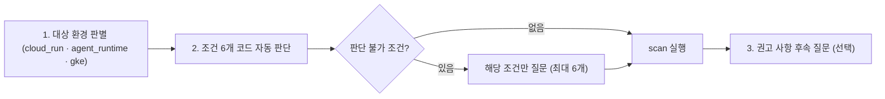

# 사전 확인: 조건 판단 · 권고 사항 맞춤화 (`intake-questionnaire.md`, 체크리스트 v3)

> **기준**: [`catalog_v3.json`](../scripts/prod_ready/catalog_v3.json)의 `conditions` · `condition_rules` · `advisories` / 정의서 [`docs/checklist-v3-spec.md`](../../../docs/checklist-v3-spec.md) §3 · §5
> 판정 규칙은 [`checklist-rubric.md`](checklist-rubric.md) §2를 따릅니다.

체크리스트 v3에서 사용자에게 묻는 것은 **조건부 항목이 해당하는지**뿐입니다. 필수 항목은 항상 점검하고, Preview 항목은 점검·표시하되 판정을 막지 않습니다. 따라서 "풀 프로덕션 / PoC" 같은 프리셋 선택은 더 이상 쓰지 않습니다.

---

## 1. 원칙 — 코드에서 먼저 판단하고, 판단하지 못한 것만 묻는다



1. **대상 환경**: 사용자가 말하지 않았으면 작업 공간에서 판별합니다 (`google_cloud_run_v2_service` → `cloud_run`, `google_vertex_ai_reasoning_engine` / `agent_engine_app.py` → `agent_runtime`, `kubernetes_deployment_v1` / `deployment/k8s/` → `gke`). 엔진의 `--target auto`도 같은 판별을 합니다.
2. **조건 자동 판단**: 아래 §2의 신호를 코드·설정에서 찾습니다. 신호가 분명하면 묻지 않고 결과만 한 줄로 알려 줍니다 (예: `멀티턴 대화: 해당 (VertexAiSessionService 사용 감지)`).
3. **질문은 판단하지 못한 조건만**, 한 번에 묶어서 짧게 묻습니다. 사용자가 이미 말한 내용은 다시 묻지 않습니다.

---

## 2. 조건과 적용 항목

| 조건 (`conditions` 키) | 판단 기준 (질문) | 적용 항목 (v4 ID) | 코드 자동 판단 신호 |
| :--- | :--- | :--- | :--- |
| **멀티턴 대화** (`conv`) | 이전 대화를 이어가야 하는가 | 관리형 영속 세션 저장 (VertexAiSessionService) — `AR-RS1` · `CR-RS1` · `GKE-RS1` | `SessionService` 사용, `session_id`를 요청 간 전달, 채팅 UI·`/run_sse` 대화 엔드포인트, `get_fast_api_app(session_service_uri=...)` |
| **장기 기억 필요** (`memory`) | 세션을 넘어 사용자를 기억해야 하는가 | 관리형 장기 기억 저장 (VertexAiMemoryBankService) — `AR-RS2` · `CR-RS2` · `GKE-RS2` | `MemoryService` · `VertexAiMemoryBankService`, `load_memory` / `PreloadMemoryTool`, `add_session_to_memory`, 사용자 프로필·선호 저장 로직 |
| **AI 생성 코드 실행** (`code`) | AI가 만든 코드·셸을 실행하는가 | Code Execution — `AR-SF2` / Cloud Run sandboxes (Preview) — `CR-SF2` / Agent Substrate on GKE — `GKE-SF1` (AI 생성 코드 격리) | `BuiltInCodeExecutor` · `UnsafeLocalCodeExecutor` · `ContainerCodeExecutor`, `subprocess` / `exec(` / `eval(`를 도구로 노출, 셸·브라우저·computer-use 도구 |
| **자주 일시정지·재개하는 상태 유지형 에이전트** (`idle`) | 사용자 입력·도구 응답을 기다리는 시간이 대부분인가 | 에이전트 일시정지 · 복원 (Agent Substrate · Agent Sandbox) — `GKE-RS4` (GKE 전용) | 코드로 판단 불가 → Agent Substrate(`ate.dev/v1alpha1` `WorkerPool` / `ActorTemplate`)를 이미 쓰면 해당, 아니면 **사용자에게 질문**. 해당이면 `--conditions idle=true` |
| **MCP·외부 도구 호출** (`tools`) | MCP 서버·외부 API·다른 에이전트를 호출하는가 | Agent Gateway (외부 호출 통제) — `AR-SF1` · `CR-SF1` / Agent Gateway for GKE (외부 호출 통제) — `GKE-SF2` | `McpToolset` · `StreamableHTTPConnectionParams` · `SseConnectionParams`, `RemoteA2aAgent`, `AgentRegistry.get_mcp_toolset()`, `OpenAPIToolset`, 외부 URL로의 `httpx`/`requests` 호출 도구 |
| **사용자 대신 외부 도구 호출** (`delegated`) | 사용자 계정으로 외부 시스템(Jira·GitHub 등)을 호출하는가 | 사용자 위임 인증 (Agent Identity auth manager) — `COMMON-ID1` (전 환경 공통 · Preview) | auth manager 사용(`google.adk.integrations.agent_identity`, `GcpAuthProvider` / `GcpAuthProviderScheme`, `…/authProviders/…`), 인증 헤더(`headers=` · `Authorization` · `auth_scheme` · `auth_credential`)를 붙인 MCP·OpenAPI·서드파티 API 도구, `*_TOKEN` · `*_API_KEY` · `GITHUB_PAT` 같은 환경변수 (Gemini 키 제외). 감지되지 않으면 **사용자에게 질문**하고, 해당이면 `--conditions delegated=true` |

- 조건이 **해당하지 않으면** 그 항목은 `N/A`로 표시하고 판정에서 제외합니다.
- Agent Gateway 항목(`AR-S3` · `CR-S4` · `GKE-S4`)과 사용자 위임 인증 항목(`AR-S5` · `CR-S6` · `GKE-S5`)은 **Preview**라 조건이 해당해도 판정을 막지 않습니다.
- `GKE-O2`는 조건을 코드로 판단할 수 없어 기본은 `N/A`입니다. 사용자가 "해당"이라고 답하면 `scan`/`report`에 `--conditions idle=true`를 붙이고, 적용은 `--items GKE-O2`(명시 선택)로 합니다.
- AI 생성 코드 격리는 환경별 항목입니다: Agent Runtime `AR-S4`(Code Execution) · Cloud Run `CR-S5`(Cloud Run sandboxes, Preview) · GKE `GKE-S2`(Agent Substrate). `AR-S4` · `CR-S5`는 점검·안내만 하고 자동 패치하지 않습니다.
- 사용자 위임 인증(`AR-S5` · `CR-S6` · `GKE-S5`)도 점검·안내만 합니다: 🟢 `google-adk[agent-identity]` extra + auth provider 연결 · 🔴 정적 API 키·PAT를 도구 헤더에 전달 · 🟡 그 외. auth manager에 auth provider(3-legged OAuth)를 만들고 ADK 도구·MCP에 연결하도록 안내합니다 ([Agent Identity auth manager](https://docs.cloud.google.com/iam/docs/auth-manager-overview) · [3-legged OAuth with auth manager](https://docs.cloud.google.com/iam/docs/auth-with-3lo-v2)).

> [!NOTE]
> 엔진이 조건을 자동 판단하므로 대부분은 질문 없이 `scan`을 실행할 수 있습니다. 사용자가 "해당 없음"이라고 답한 조건부 항목은 `--items`에서 빼고 실행합니다 (예: Cloud Run에서 멀티턴 대화가 아니면 `CR-F1`을 제외).

---

## 3. 질문 템플릿 (판단하지 못한 조건만)

### 선택형 도구(`ask_question` / `ask_user`)가 있을 때

판단하지 못한 조건마다 질문 하나, 선택지는 `예` / `아니오` 두 개로 묶어서 한 번에 묻습니다.

- `이 에이전트는 이전 대화를 이어가야 하나요? (멀티턴 대화)`
- `세션이 끝난 뒤에도 사용자의 선호·사실을 기억해야 하나요? (장기 기억)`
- `AI가 만든 코드나 셸 명령을 실행하나요?`
- `사용자 입력·도구 응답을 기다리는 시간이 대부분인 대화형 에이전트인가요? (유휴 일시정지 · 복원, GKE만 해당)`
- `MCP 서버·외부 API·다른 에이전트를 호출하나요?`
- `사용자 계정으로 외부 시스템(Jira·GitHub 등)을 호출하나요? (사용자 위임 인증)`

### 텍스트 대체 (선택형 도구가 없을 때)

```text
코드에서 판단하지 못한 조건만 확인합니다 (예/아니오):
  1. 이전 대화를 이어가야 하나요? (멀티턴 대화)
  2. 세션을 넘어 사용자를 기억해야 하나요? (장기 기억)
  3. AI가 만든 코드·셸을 실행하나요?
  4. 사용자 입력·도구 응답을 기다리는 시간이 대부분인가요? (GKE만 해당 · 유휴 일시정지 · 복원)
  5. MCP 서버·외부 API·다른 에이전트를 호출하나요?
  6. 사용자 계정으로 외부 시스템(Jira·GitHub 등)을 호출하나요? (사용자 위임 인증)
```

목록에는 판단하지 못한 조건만 남기고 번호를 다시 매깁니다.

---

## 4. 선택 항목별 적용 전 설정 질문 (Feature-by-Feature Configuration)

`scan` 결과와 항목별 1줄 설명을 본 사용자가 **적용할 항목을 직접 선택(Select)**하면, **1개 항목씩 순차 진행**하면서 그 항목에 필요한 설정만 짧게 묻고 `diff` → 승인 → `apply` 순서로 반영합니다.

| 선택 항목 | 적용 전 확인할 설정 질문 | 매핑 `--params` 키 / 동작 |
| :--- | :--- | :--- |
| **Agent Gateway** (`AR-SF1` · `CR-SF1` · `GKE-SF2`) | ① **적용 방향**: Egress (에이전트→외부 도구/MCP) / Ingress (클라이언트→에이전트) / Both (양방향)<br>② **초기 적용 모드**: `DRY_RUN` (감사 로그 확인 후 전환 권장) vs `ENFORCED`<br>③ **Model Armor 연동**: 프롬프트 인젝션·민감정보(SDP) 검사 템플릿 함께 구성할지 여부 | `agent_gateway_direction` (`"egress"` \| `"ingress"` \| `"both"`), `agent_gateway_enforcement_mode` (`"DRY_RUN"` \| `"ENFORCED"`), `enable_model_armor` (`true` \| `false`) *(Cloud Run `CR-SF1`은 답변에 맞춰 수동 YAML/CLI 가이드 출력)* |
| **Cloud Run 신원 · 레지스트리** (`CR-ID2` · `CR-ID3`) | ① **신원 방식**: 전용 최소 권한 서비스 계정 (`service_account`, 안정·권장) vs Agent Identity (`agent_identity`, Preview SPIFFE)<br>② `agent_identity` 선택 시 **조직 ID** (`organization_id`, 미입력 시 `gcloud projects get-ancestors` 안내) | `cloud_run_identity_mode` (`"service_account"` \| `"agent_identity"`), `organization_id` |
| **평가 게이트** (`COMMON-DO2`) | 평가 통과 **기준 점수** (1.0~5.0, 기본 `3.5`) | `eval_threshold` |
| **영속 세션 · 장기 기억** (`CR-RS1/RS2` · `GKE-RS1/RS2`) | 이미 만들어 둔 Agent Platform Reasoning Engine ID가 있는지 (있으면 연결, 없으면 신규 생성 안내) | `agent_engine_id` |
| **GKE 무중단 종료** (`GKE-RS3`) | 에이전트 한 턴의 최대 응답 시간에 맞춘 **종료 유예 시간(초)** (기본 `120`초) | `gke_termination_grace_seconds` |
| **GKE 코드 격리 · 유휴 일시정지** (`GKE-SF1` · `GKE-RS4`) | 클러스터/워크로드에 맞는 **실행 패턴**: `agent_substrate` (Standard ≥ 1.37 권장) vs `agent_sandbox` (상시 실행 · 사이드카 · Arm · Autopilot) | `gke_execution_pattern` |
| **BigQuery Agent Analytics** (`COMMON-DO3`, 전 환경 공통 · 선택 Add-on) | ① BigQuery **데이터셋 ID** (기본 `agent_analytics`)<br>② **테이블명** (기본 `agent_events`)<br>*(공식 근거: [ADK BigQuery Agent Analytics](https://adk.dev/integrations/bigquery-agent-analytics/))* | `bq_analytics_dataset`, `bq_analytics_table` |
| **Model Armor 입·출력 가드레일** (`COMMON-SF1`, 전 환경 공통 · 선택 Add-on · 유료) | ① **신뢰도 임계치**: `LOW_AND_ABOVE` / `MEDIUM_AND_ABOVE`(기본) / `HIGH`<br>② **민감정보(SDP) 필터** 활성 여부 (기본 `true`)<br>③ **악성 URI 필터** 활성 여부 (기본 `true`)<br>*(공식 근거: [Model Armor Overview](https://cloud.google.com/security-command-center/docs/model-armor-overview) · [Well-Architected AI & ML](https://cloud.google.com/architecture/framework/perspectives/ai-ml))* | `model_armor_confidence`, `model_armor_enable_sdp`, `model_armor_enable_malicious_uri` |
| **고위험 도구 실행 승인 · HITL** (`COMMON-SF2`, 전 환경 공통 · 선택 Add-on · 안내 전용) | 사람 승인이 필요한 **고위험 도구 목록**(결제·삭제·외부 쓰기 등) 확인 → `FunctionTool(..., require_confirmation=True)` / `ToolConfirmation` 적용 코드 안내<br>*(공식 근거: [ADK Tool Confirmation](https://google.github.io/adk-docs/tools/confirmation/) · [ADK Safety](https://google.github.io/adk-docs/safety/))* | (안내 전용 · 자동 파일 수정 없음) |
| **Online Evaluation Monitor** (`AR-DO2`, Agent Runtime 전용 · 선택 Add-on) | 실시간 샘플링 비율 및 추가 LLM 평가 과금 승인 확인 → `agent-platform-alert-configuration` 스킬로 Online Monitor 구성 | (안내 전용 · 스킬 연계) |
| **단일 정답 항목** (`CR-ID1`, `CR-DO1`, `AR-DO1`, `GKE-DO1`, `AR-ID1`, `GKE-ID1`) | 추가 질문 없음 — 바로 `diff` 미리보기로 진행 | (기본 패치) |
| **기타 안내 전용 항목** (`COMMON-DO1`, `COMMON-ID1`, `AR-SF2`, `CR-SF2`) | 사용자 환경(CI/CD 러너, 외부 OAuth 시스템 등)에 맞춰 수동 설정 절차·코드 예시 안내 | (자동 파일 수정 없음; `COMMON-DO1`만 승인 시 `agents-cli scaffold enhance` 실행) |

---

## 5. 권고 사항 후속 질문 (선택 · 판정과 무관)

`scan` 결과를 보여 준 뒤, 사용자에게 관련이 있어 보일 때만 짧게 덧붙입니다. 답에 따라 [`checklist-rubric.md`](checklist-rubric.md) §6의 권고 사항을 골라 안내합니다. 체크리스트 판정에는 영향을 주지 않습니다.

| 후속 질문 | 안내할 권고 사항 (대상) |
| :--- | :--- |
| 기동이 느린 런타임인가요? 콜드스타트가 문제인가요? | 시작 CPU 부스트 · 1세대 / 2세대 실행 환경 (Cloud Run) |
| 한 턴의 최대 응답 시간과 지연 민감도는? | 요청 타임아웃 · 최소 인스턴스 (Cloud Run) / 최소/최대 인스턴스 · 동시성 (Agent Runtime) / HPA · 리소스 요청/한도 (GKE) |
| 외부 호출을 통제해야 하는데 Agent Gateway를 쓸 수 없나요? | Secure Web Proxy (이그레스 프록시) (전 환경, 비용 발생) |
| 외부 사용자 대상이거나 민감정보를 다루나요? | Model Armor (프롬프트·응답 검사) (전 환경, 비용 발생) |
| 에이전트를 인터넷에 직접 노출하나요? | Cloud Armor · IAP (외부 노출 보호) (Cloud Run · GKE, 비용 발생) |
| 데이터 레지던시로 리전을 고정하나요? SLA가 필요한가요? | 모델 용량 확보 (Provisioned Throughput 등) (전 환경) |

---

## 6. 선택 `--params` (diff / apply 단계)

엔진 버전에 따라 키가 바뀔 수 있으니 실제 값은 `python3 <SKILL_DIR>/scripts/prod_ready.py diff --help`와 diff 결과로 확인합니다.

| 키 | 기본값 | 대상 | 관련 항목 |
| :--- | :--- | :---: | :--- |
| `agent_engine_id` | `""` | `cloud_run`, `gke` | Agent Platform 인스턴스 ID — `VertexAiSessionService` · Memory Bank 연결 (`CR-F1`·`CR-F2`·`GKE-F1`·`GKE-F2`) |
| `eval_threshold` | `3.5` | 전체 | 평가 게이트 기준 점수 (`CR-D2`·`AR-D2`·`GKE-D2`) |
| `gke_termination_grace_seconds` | `120` | `gke` | `terminationGracePeriodSeconds` — 최대 응답 시간 이상 (`GKE-O1`) |
| `gke_execution_pattern` | `"standard_pods"` | `gke` | `agent_substrate`(Agent Substrate on GKE) 또는 `agent_sandbox`(상시 실행 · 사이드카 · Arm · Autopilot) (`GKE-S2`) |
| `agent_gateway_direction` | `"egress"` | `agent_runtime` | Agent Gateway 적용 방향 — `"egress"` (`AGENT_TO_ANYWHERE`), `"ingress"` (`CLIENT_TO_AGENT`), `"both"` (`AR-S3`, Preview) |
| `agent_gateway_enforcement_mode` | `"DRY_RUN"` | `agent_runtime` | Agent Gateway 정책을 시험 모드로 검증한 뒤 `"ENFORCED"`로 전환 (`AR-S3`, Preview) |
| `enable_model_armor` | `false` | `agent_runtime` | `true`일 때 Model Armor 템플릿(`pi_and_jailbreak` + `sdp`)과 `CONTENT_AUTHZ` 정책을 `production_ready.tf`에 함께 생성 (`AR-S3`, Preview) |
| `cloud_run_identity_mode` | `"agent_identity"` | `cloud_run` | `CR-S3` 적용 시 Cloud Run 신원 모드 — `"service_account"`(전용 최소 권한 SA 유지, 권장·안정) 또는 `"agent_identity"`(Preview SPIFFE) |
| `organization_id` | `""` | `cloud_run` | `cloud_run_identity_mode="agent_identity"`일 때 `variables.tf`의 `organization_id` 기본값으로 반영 (`CR-S3`) |
| `bq_analytics_dataset` | `"agent_analytics"` | 전체 | BigQuery Agent Analytics 데이터셋 ID (`AR-OB2`·`CR-OB2`·`GKE-OB2`, 선택 Add-on) |
| `bq_analytics_table` | `"agent_events"` | 전체 | BigQuery Agent Analytics 테이블명 (`AR-OB2`·`CR-OB2`·`GKE-OB2`, 선택 Add-on) |
| `model_armor_confidence` | `"MEDIUM_AND_ABOVE"` | 전체 | Model Armor 프롬프트 인젝션·탈옥 신뢰도 임계치 — `LOW_AND_ABOVE` / `MEDIUM_AND_ABOVE` / `HIGH` (`AR-S6`·`CR-S7`·`GKE-S6`, 선택 Add-on) |
| `model_armor_enable_sdp` | `true` | 전체 | Model Armor Sensitive Data Protection(민감정보 PII) 필터 활성 여부 (`AR-S6`·`CR-S7`·`GKE-S6`) |
| `model_armor_enable_malicious_uri` | `true` | 전체 | Model Armor 악성 URI 필터 활성 여부 (`AR-S6`·`CR-S7`·`GKE-S6`) |
